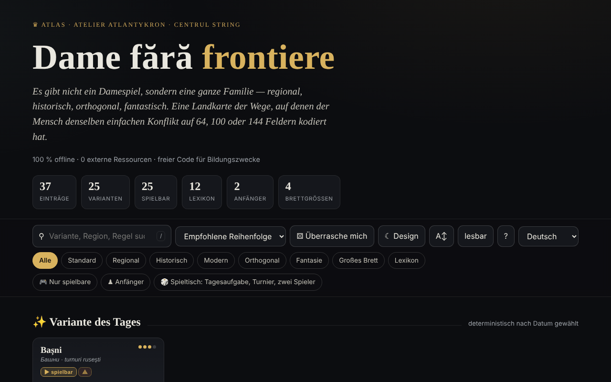

# Dame fără frontiere

[English](README.md) · [Română](README.ro.md) · [Français](README.fr.md) · [Italiano](README.it.md) · [Español](README.es.md) · [Português](README.pt.md) · **Deutsch** · [Magyar](README.hu.md)

**Version:** 2.2.0 · **Zuletzt aktualisiert:** 2026-10-27

Oberflächensprachen: **Română, English, Français, Italiano, Español, Português (PT), Deutsch, Magyar**

Atlas der Dame-Varianten, mit lokalen Spiel-Engines — in einer einzigen HTML-Datei.

**Online-App:** https://chiuta.github.io/Dame-fara-frontiere/

## Was es ist

Dame fără frontiere („Dame ohne Grenzen“) ist ein interaktiver Atlas der Familie der Damespiele (regional, historisch, orthogonal, fantastisch) auf Brettern mit 64, 100 oder 144 Feldern. Jede Variante hat ein Blatt mit Regeln und Kurzdaten, und die spielbaren Varianten können lokal gegen den Computer gespielt werden. Die App versteht sich als Begleiter des Projekts „Șah fără frontiere“ („Schach ohne Grenzen“).

## Funktionen

- 25 Varianten (internationale, englische, brasilianische, russische, kanadische, italienische, spanische, portugiesische, tschechische, deutsche, Pool, die übliche RO-Variante, thailändische, türkische, friesische, armenische, Dameo, Croda, Lasca, Bashni, Cheskers, Damath, Verlustdame, internationale Verlustdame, diagonale Dame) und 12 Lexikoneinträge (Dame, Schlagzwang, Mehrheitsschlag, fliegende Dame, numerische Notation, FMJD, Umwandlung usw.).
- Suche, Sortierung (empfohlene Reihenfolge, Titel A→Z / Z→A, Schwierigkeit aufsteigend / absteigend), Filter „Nur spielbare“ und „Anfänger“, „Variante des Tages“ (deterministisch nach Datum gewählt), „Überrasch mich“.
- Lokales Spiel „Lokal spielen · vs KI“: Du wählst die Farbe (Weiß / Schwarz) und die Stufe (Leicht / Mittel / Fortgeschritten), mit „Neues Spiel“, „Rückgängig“, „Hinweis“ und „Entspannter Modus“ (Schlagen nicht zwingend).
- „⧉ Partie kopieren“ und „⤓ .txt speichern“ im Spielfenster: ein Kopf (Variante, Brett, Stufe, Ergebnis) und die Züge in Koordinatennotation (kein offizielles PDN); lokal erzeugt.
- Lokale Engines: generisch parametrisiert, Türme (Bashni, Lasca), arithmetische Wertung (Damath) und Hybrid Schach×Dame (Cheskers), mit Alpha-Beta-Suche. Die App warnt mit ⚠ vor nur näherungsweise implementierten Varianten.
- CSV-Export der Liste und BibTeX-Zitat.
- Helles/dunkles Design, Textgröße „lesbar“.

## Neue Funktionen (1.1.0) — „Spieltisch“

Sie öffnen sich über die Schaltfläche „🎲 Spiel zu zweit · Analyse · täglich“ (im Spielfenster) oder „🎲 Spieltisch“ (auf der Hauptseite), in einem Dialog mit fünf Reitern:

- **Spiel zu zweit über FFF.p2p** — zwei Personen, WebRTC direkt zwischen Browsern, **ohne Server**: Ihr tauscht manuell zwei Codes aus (Kopieren/Einfügen oder QR-Code), dann läuft das Spiel im „Lockstep“: Der Gastgeber (Weiß) validiert und nummeriert jeden Zug, der Gast (Schwarz) wendet ihn erst nach dem Echo des Gastgebers an; bei jeder Abweichung wird der vollständige Zustand neu gesendet. Funktioniert für die spielbaren Dame-Varianten (die Variante wählst du beim Gastgeber). Leiste „Online-Spiel“ mit Remis / neues Spiel (Angebot + Annehmen/Ablehnen), Aufgabe und Trennung; bei Trennung kannst du allein von der aktuellen Stellung aus weiterspielen. **Grenzen:** Symmetrische NATs (Mobilfunk-/Firmennetze) lassen sich ohne STUN/TURN nicht durchqueren; ein STUN-Server kann eingetragen werden (Opt-in, standardmäßig leer) — dann gelangt die öffentliche IP-Adresse zu diesem Server; die Gegner sehen gegenseitig ihre IP-Adresse; eine unterbrochene Partie wird nach dem Neuladen der Seite nicht fortgesetzt; es gibt keinen Chat.
- **Lokaler Analysator** — „Stellung analysieren“ (Bewertung in „Steinen“, der beste Zug und die Rangfolge der Züge, Alpha-Beta-Suche mit Zeitlimit ≈ 0,7 s, die Tiefe hängt also vom Gerät ab) und „Partie analysieren“ (bewertet jede Stellung, markiert die Fehler). Bei Damath und Cheskers ist die Bewertung nur materiell (in der Oberfläche angegeben). Er ersetzt keine professionelle Engine; im Online-Spiel deaktiviert.
- **Tagesaufgabe** — eine „Finde den besten Zug“-Aufgabe, **deterministisch aus dem Datum** erzeugt (am selben Tag für alle gleich, ohne Netzwerk; Suche mit fester Tiefe, nicht zeitbasiert); Erklärung bei falschem Zug (die Bewertungsdifferenz) und Serie gelöster Tage (lokal).
- **„❓ Warum kann ich nicht ziehen?“** — Du tippst auf eine Figur oder ein unzulässiges Feld, und die App sagt, warum (du bist nicht am Zug, die Figur gehört dem Gegner, es besteht Schlagzwang, die Figur hat keine Züge, der Zug setzt einen Mehrfachschlag fort usw.); Schaltfläche und Taste `W`.
- **Tastaturspiel und Audioansagen** — Auswahl und Zug mit Pfeilen/Enter auf dem Brett, Tasten `L` (letzter Zug), `S` (Status), `M` (ziehbare Figuren), `W` (warum kann ich nicht ziehen); Ansagen in einem `aria-live`-Bereich und optional per Stimme (Web Speech, falls der Browser eine Stimme in der Sprache der Seite hat; sonst sagt sie ausdrücklich, dass sie nicht verfügbar ist).
- **Lokales Elo-Turnier** — Ich, leichte/mittlere/fortgeschrittene KI und weitere Personen am selben Brett, Jeder-gegen-jeden (optional mit Hin- und Rückrunde); die Partien werden auf dem Brett gespielt oder KI–KI mit fester Tiefe simuliert; Rangliste und Elo werden aus den Ergebnissen neu berechnet; JSON/CSV-Export und Import. Die Elo-Skala ist **intern** im Turnier und nicht mit FIDE/FMJD vergleichbar.

Tests: `node tests/fff-r8.test.mjs` (Playwright, Netzwerk gesperrt, 2 Seiten für P2P, axe).

## Bedienungsanleitung

1. Öffne die Seite und blättere durch die Karten; filtere mit „Nur spielbare“ oder „Anfänger“ oder suche mit `/`.
2. Öffne ein Blatt (Zusammenfassung, „Schlüsselregeln“, „Kurzdaten“, „Verwandte“).
3. Hat die Variante eine Engine, drücke „▶ Lokal spielen · vs KI“, wähle Farbe und Stufe.
4. Drücke auf dem Brett eine Figur, dann ein hervorgehobenes Feld. Bei Mehrfachschlägen drückst du weiter auf die Felder; die Folge wird angewendet, wenn sie vollständig ist.
5. Nutze „↶ Rückgängig“, „💡 Hinweis“ oder „↺ Neues Spiel“; der „Entspannte Modus“ macht das Schlagen freiwillig.
6. Kürzel: `/` fokussiert die Suche, `R` zufällige Variante, `B` Anfängerfilter, `T` wechselt das Design, `A` Textgröße, `Esc` schließt das Fenster.
7. „⤓ CSV exportieren“ lädt die Liste herunter; „⤓ Zitieren (BibTeX)“ bietet das Zitat an.
8. „Über diesen Atlas →“ erklärt das Thema, die Engines und die Grenzen (didaktische Engines, nicht für professionelle Analyse).

## Datenschutz und Netzwerk

- **Lokaler Speicher:** `localStorage`, Schlüssel mit dem Präfix `dff_` (Design, lesbarer Modus, erkundete Varianten, eine interne Markierung) und `dff_r8_` (Einstellungen für Ansagen/Stimme, Turnier, Tagesserie, Cache der Tagesaufgabe); das FFF-Kit ergänzt die Sicherung (Export/Import/Löschen) und das Fenster „Transparenz“ über die Versionsnummer.
- **Netzwerk:** Im Code gibt es kein `fetch`, keine CDNs oder externen Ressourcen (deklarierter Egress: 0); die einzige Kommunikation ist das optionale Spiel zu zweit, über WebRTC direkt zwischen den beiden Spielern, mit manueller Signalisierung (von euch ausgetauschte Codes) und, nur wenn du einen einträgst, einem STUN-Server; die App erklärt „0 externe Ressourcen“, ohne Konto und ohne Tracking. Die Links zu Buy Me a Coffee, creativecommons.org oder alexio.tf sind einfache Hyperlinks, die nur per Klick geöffnet werden.

## Lokale / Offline-Ausführung

Lade `index.html` herunter und öffne die Datei im Browser; es ist kein Internet nötig.

## Lizenz

MIT-Lizenz — siehe Datei `LICENSE`. Der Kopf von `index.html` und der Text der Oberfläche nennen dieselbe Lizenz (ein früherer Hinweis „CC-BY-SA 4.0“ in der Oberfläche wurde beim Audit, 2026-10-11, entfernt, um den Widerspruch zu beseitigen).

## Verlauf / Changelog

- 1.2.5 — 2026-10-22: fff-kit 1.1.4: Touch-Ziele und Mindestschriftgröße
- 1.2.4 — 2026-10-22: fff-kit 1.1.2: PBKDF2 mit 600.000 Iterationen, Schutz vor Clickjacking
- 1.2.3 — 2026-10-22: Feinschliff für Mobilgeräte und Barrierefreiheit: Text mit mindestens 12 px und Touch-Ziele von mindestens 24 px. sichtbarer Tastaturfokus bei jedem Steuerelement.
- 1.1.0 — 2026-10-14 (Runde 8, C1a): Spieltisch — P2P-Spiel zu zweit, lokaler Analysator, Tagesaufgabe, „Warum kann ich nicht ziehen?“, Tastatur + Audioansagen, lokales Elo-Turnier; FFF-Kit (core, label, bundle, qr, p2p, tts) mit `app.json`; CSP: `script-src` mit neu berechneten Hashes (+ `blob:` wie üblich für das Kit); Tests `tests/fff-r8.test.mjs`.
- 1.0.0 — 2026-10-12: Version und Datum der letzten Aktualisierung werden in der App angezeigt
- Runde 7: Das Brett im dunklen Design hat nun deutlich unterscheidbare Felder (Kontrast ≈ 3:1) und schwarze Figuren mit hellem Rand; in Damath waren die Operatoren (+ − × ÷) und die Werte auf den Figuren sowie die Buchstaben der Figuren in Cheskers mit ~4,5 px geschrieben und skalieren jetzt mit der Brettgröße (≈ 13–22 px); die Überschriften in den Fenstern (Schlüsselregeln, Kurzdaten, Kürzel usw.) sind `h3` (korrekte Hierarchie, axe `heading-order`); die Schaltfläche „Gegen KI spielen“ und die Auswahl „Weiß/Schwarz“ halten den Kontrast im hellen Design ein; das Standarddesign folgt `prefers-color-scheme`, wenn keine gespeicherte Wahl vorliegt.
- Export der aktuellen Partie hinzugefügt (Kopieren / .txt); CSP: `script-src` per SHA-256-Hash (5 Skripte), ohne `'unsafe-inline'`. Geprüft: Die Suche „englez“ lässt 6 Karten sichtbar (der Zähler zeigt „6 von 37 Einträgen“; die Karten in den ausgeblendeten Regalen bleiben im DOM, werden aber nicht angezeigt).
- Die Suche ignoriert Diakritika, akzeptiert mehrere Wörter (alle müssen vorkommen), ordnet die Ergebnisse mit Treffern im Titel zuerst und blendet die Regale „Variante des Tages / Wesentliche / Exotische“ aus, solange die Suche aktiv ist; der Zähler zeigt „N von 37 Einträgen“.
- Die Such- und Filterleiste ist ein `role="search"`-Landmark, und das Unterstützungs-Widget ist `complementary`; axe-core: 0 Verstöße bei 1280 und 360 px.
- Partieanalyse: Seit 1.1.0 gibt es einen einfachen lokalen Analysator (siehe „Neue Funktionen“); er bleibt didaktisch, nicht für professionelle Analyse.

## Marken

Die Namen von Spielen sind Handelsnamen ihrer Inhaber und werden beschreibend verwendet; das Projekt ist nicht mit ihnen verbunden.

## Audit

Audit: 2026-10-10 — geprüft mit Playwright und axe-core (WCAG 2.1 AA, beide Designs); im Code geprüft: kein `fetch`/CDN. Korrigiert: die Farbe der Kartentitel (sie erbte auf Systemen mit hellem Design nicht die Seitenfarbe), Kontrast der aktiven Schaltfläche im hellen Design, ein dekoratives fokussierbares Kontrollkästchen.

## Autor

Alexio — Alexandru-Ionuț Chiuță, Kontakt: alexio@trom.tf. Die App erwähnt Atlantykron, Editura Tornada und Centrul StrING.

## Zusammenfassung
Ein Atlas von 25 Dame-Varianten plus 12 Lexikoneinträgen, mit lokalen KI-Gegnern (Alpha-Beta-Suche) für spielbare Varianten. Eine einzige HTML-Datei, rumänische Oberfläche, keine externen Anfragen; Design und erkundete Varianten werden in localStorage gespeichert (Präfix `dff_`). Seit 1.1.0: ein „Spieltisch“ mit Online-Spiel zu zweit über WebRTC (manuelle Signalisierung, ohne Server), ein einfacher lokaler Analysator, eine deterministische Tagesaufgabe, Erklärungen „Warum kann ich nicht ziehen?“, Tastaturspiel mit gesprochenen Ansagen und ein lokales Elo-Turnier. MIT-lizenziert (siehe LICENSE).
