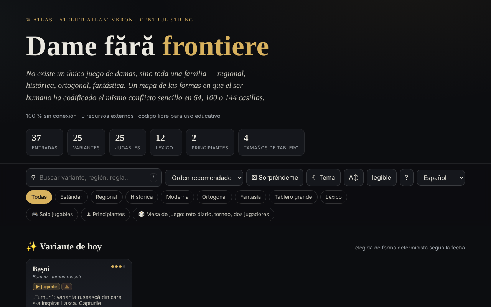

# Dame fără frontiere

[English](README.md) · [Română](README.ro.md) · [Français](README.fr.md) · [Italiano](README.it.md) · **Español** · [Português](README.pt.md) · [Deutsch](README.de.md) · [Magyar](README.hu.md)

**Versión:** 1.2.5 · **Última actualización:** 2026-10-22

Idiomas de la interfaz: **Română, English, Français, Italiano, Español, Português (PT), Deutsch, Magyar**

Atlas de las variantes del juego de damas, con motores de juego locales — en un único archivo HTML.

**Aplicación en línea:** https://chiuta.github.io/Dame-fara-frontiere/

## Qué es

Dame fără frontiere («Damas sin fronteras») es un atlas interactivo de la familia de juegos de damas (regionales, históricos, ortogonales, fantásticos), en tableros de 64, 100 o 144 casillas. Cada variante tiene una ficha con reglas y datos rápidos, y las variantes jugables se pueden jugar en local contra el ordenador. La aplicación se declara compañera del proyecto «Șah fără frontiere» («Ajedrez sin fronteras»).

## Funciones

- 25 variantes (internacional, inglesa, brasileña, rusa, canadiense, italiana, española, portuguesa, checa, alemana, pool, la variante habitual RO, tailandesa, turca, frisona, armenia, Dameo, Croda, Lasca, Bashni, Cheskers, Damath, damas a perder, damas internacionales a perder, damas diagonales) y 12 entradas de léxico (dama, captura obligatoria, captura mayoritaria, dama voladora, notación numérica, FMJD, promoción, etc.).
- Búsqueda, ordenación (orden recomendado, título A→Z / Z→A, dificultad ascendente / descendente), filtros «Solo jugables» y «Principiantes», «Variante de hoy» (elegida de forma determinista según la fecha), «Sorpréndeme».
- Juego local «Jugar en local · vs IA»: eliges el color (Blancas / Negras) y el nivel (Fácil / Medio / Avanzado), con «Nueva partida», «Deshacer», «Pista» y «Modo relajado» (captura no obligatoria).
- «⧉ Copiar la partida» y «⤓ Guardar .txt» en la ventana de juego: una cabecera (variante, tablero, nivel, resultado) y las jugadas en notación por coordenadas (no PDN oficial); generadas en local.
- Motores locales: genérico parametrizado, de torres (Bashni, Lasca), de puntuación aritmética (Damath) e híbrido ajedrez×damas (Cheskers), con búsqueda alfa-beta. La aplicación avisa con ⚠ de las variantes implementadas de forma aproximada.
- Exportación CSV de la lista y cita BibTeX.
- Tema claro/oscuro, tamaño de texto «legible».

## Novedades (1.1.0) — «Mesa de juego»

Se abren desde el botón «🎲 Partida de dos · análisis · diario» (en la ventana de juego) o «🎲 Mesa de juego» (en la página principal), en un cuadro de diálogo con cinco pestañas:

- **Partida de dos mediante FFF.p2p** — dos personas, WebRTC directamente entre navegadores, **sin servidor**: intercambiáis manualmente dos códigos (copiar/pegar o código QR), y luego la partida se desarrolla en «lockstep»: el anfitrión (las Blancas) valida y numera cada jugada, el invitado (las Negras) la aplica solo tras el eco del anfitrión; ante cualquier divergencia se reenvía el estado completo. Funciona para las variantes de damas jugables (eliges la variante en el anfitrión). Barra «Partida en línea» con tablas / nueva partida (oferta + aceptar/rechazar), abandono y desconexión; al desconectarse puedes continuar solo desde la posición actual. **Límites:** los NAT simétricos (redes móviles/corporativas) no se pueden atravesar sin STUN/TURN; se puede rellenar un servidor STUN (opt-in, vacío por defecto) — entonces la dirección IP pública llega a ese servidor; los adversarios ven mutuamente su dirección IP; una partida interrumpida no se reanuda tras recargar la página; no hay chat.
- **Analizador local** — «Analizar la posición» (evaluación en «piezas», la mejor jugada y la clasificación de las jugadas, búsqueda alfa-beta con límite de tiempo ≈ 0,7 s, por lo que la profundidad depende del dispositivo) y «Analizar la partida» (evalúa cada posición, marca los errores). Para Damath y Cheskers la evaluación es solo material (se indica en la interfaz). No sustituye a un motor profesional; desactivado en la partida en línea.
- **Reto del día** — un problema «encuentra la mejor jugada» generado **de forma determinista a partir de la fecha** (el mismo para todos el mismo día, sin red; búsqueda de profundidad fija, no por tiempo); explicación ante la jugada errónea (la diferencia de evaluación) y racha de días resueltos (en local).
- **«❓ ¿Por qué no puedo mover?»** — tocas una pieza o una casilla no permitida y la aplicación dice por qué (no es tu turno, la pieza es del adversario, existe una captura obligatoria, la pieza no tiene jugadas, la jugada continúa una captura múltiple, etc.); botón y tecla `W`.
- **Juego con teclado y anuncios de audio** — selección y movimiento con flechas/Intro en el tablero, teclas `L` (última jugada), `S` (estado), `M` (piezas que pueden mover), `W` (por qué no puedo mover); anuncios en una región `aria-live` y, opcionalmente, voz (Web Speech, si el navegador tiene una voz en el idioma de la página; si no, dice explícitamente que no está disponible).
- **Torneo Elo local** — Yo, IA fácil/media/avanzada y otras personas en el mismo tablero, liga todos contra todos (opcionalmente ida y vuelta); las partidas se juegan en el tablero o se simulan IA–IA con profundidad fija; la clasificación y el Elo se recalculan a partir de los resultados; exportación JSON/CSV e importación. La escala Elo es **interna** del torneo, no comparable con la FIDE/FMJD.

Pruebas: `node tests/fff-r8.test.mjs` (Playwright, red bloqueada, 2 páginas para P2P, axe).

## Manual de uso

1. Abre la página y recorre las tarjetas; filtra con «Solo jugables» o «Principiantes», o busca con `/`.
2. Abre una ficha (resumen, «Reglas clave», «Datos rápidos», «Relacionadas»).
3. Si la variante tiene motor, pulsa «▶ Jugar en local · vs IA», elige el color y el nivel.
4. En el tablero pulsa una pieza y luego una casilla resaltada. En las capturas múltiples sigue pulsando las casillas; la secuencia se aplica cuando está completa.
5. Usa «↶ Deshacer», «💡 Pista» o «↺ Nueva partida»; el «Modo relajado» hace la captura no obligatoria.
6. Atajos: `/` pone el foco en la búsqueda, `R` variante aleatoria, `B` filtro de principiantes, `T` cambia el tema, `A` tamaño del texto, `Esc` cierra la ventana.
7. «⤓ Exportar CSV» descarga la lista; «⤓ Citar (BibTeX)» ofrece la cita.
8. «Acerca de este atlas →» explica el tema, los motores y los límites (motores didácticos, no para análisis profesional).

## Privacidad y red

- **Almacenamiento local:** `localStorage`, claves con el prefijo `dff_` (tema, modo legible, variantes exploradas, un marcador interno) y `dff_r8_` (preferencias de anuncios/voz, torneo, racha diaria, caché del problema del día); el kit FFF añade copia de seguridad (exportar/importar/borrar) y la ventana «Transparencia» desde el número de versión.
- **Red:** en el código no hay `fetch`, CDN ni recursos externos (egress declarado: 0); la única comunicación es la partida de dos opcional, mediante WebRTC directamente entre los dos jugadores, con señalización manual (códigos que intercambiáis vosotros) y, solo si introduces uno, un servidor STUN; la aplicación afirma «0 recursos externos», sin cuenta y sin seguimiento. Los enlaces a Buy Me a Coffee, creativecommons.org o alexio.tf son simples hipervínculos, abiertos solo al hacer clic.

## Ejecución local / sin conexión

Descarga `index.html` y ábrelo en el navegador; no requiere internet.

## Licencia

Licencia MIT — véase el archivo `LICENSE`. La cabecera de `index.html` y el texto de la interfaz indican la misma licencia (una mención anterior de «CC-BY-SA 4.0» en la interfaz se eliminó en la auditoría, 2026-10-11, para eliminar la contradicción).

## Historial / Changelog

- 1.2.5 — 2026-10-22: fff-kit 1.1.4: objetivos táctiles y tamaño mínimo de texto
- 1.2.4 — 2026-10-22: fff-kit 1.1.2: PBKDF2 600 000 iteraciones, protección anti-clickjacking
- 1.2.3 — 2026-10-22: mejoras para móvil y accesibilidad: texto de al menos 12 px y áreas táctiles de al menos 24 px. foco de teclado visible en cada control.
- 1.1.0 — 2026-10-14 (ronda 8, C1a): Mesa de juego — partida de dos P2P, analizador local, reto del día, «¿por qué no puedo mover?», teclado + anuncios de audio, torneo Elo local; kit FFF (core, label, bundle, qr, p2p, tts) con `app.json`; CSP: `script-src` con hashes recalculados (+ `blob:` como de costumbre para el kit); pruebas `tests/fff-r8.test.mjs`.
- 1.0.0 — 2026-10-12: la versión y la fecha de la última actualización se muestran en la aplicación
- Ronda 7: el tablero en el tema oscuro tiene ahora casillas claramente distintas (contraste ≈ 3:1) y piezas negras con contorno claro; en Damath los operadores (+ − × ÷) y los valores de las piezas, así como las letras de las piezas de Cheskers, estaban escritos a ~4,5 px y ahora se escalan con el tamaño del tablero (≈ 13–22 px); los títulos de las ventanas (Reglas clave, Datos rápidos, Atajos, etc.) son `h3` (jerarquía correcta, axe `heading-order`); el botón «Jugar contra la IA» y el selector «Blancas/Negras» respetan el contraste en el tema claro; el tema predeterminado sigue `prefers-color-scheme` cuando no hay una elección guardada.
- Añadida la exportación de la partida actual (copiar / .txt); CSP: `script-src` por hash SHA-256 (5 scripts), sin `'unsafe-inline'`. Verificado: la búsqueda «englez» deja 6 tarjetas visibles (el contador muestra «6 de 37 entradas»; las tarjetas de los estantes ocultos permanecen en el DOM, pero no se muestran).
- La búsqueda ignora los diacríticos, acepta varias palabras (todas deben aparecer), ordena los resultados con las coincidencias en el título primero y oculta los estantes «Variante de hoy / Esenciales / Exóticas» mientras la búsqueda está activa; el contador muestra «N de 37 entradas».
- La barra de búsqueda y filtros es un punto de referencia `role="search"`, y el widget de apoyo es `complementary`; axe-core: 0 infracciones a 1280 y 360 px.
- Análisis de partidas: desde la 1.1.0 existe un analizador local sencillo (véase «Novedades»); sigue siendo didáctico, no para análisis profesional.

## Marcas

Los nombres de juegos son denominaciones comerciales de sus titulares, usadas de forma descriptiva; el proyecto no está afiliado a ellos.

## Auditoría

Auditoría: 2026-10-10 — verificado con Playwright y axe-core (WCAG 2.1 AA, ambos temas); verificado en el código: sin `fetch`/CDN. Corregidos: el color de los títulos de las tarjetas (no heredaba el color de la página en sistemas con tema claro), el contraste del botón activo en el tema claro, una casilla de verificación decorativa con posibilidad de foco.

## Autor

Alexio — Alexandru-Ionuț Chiuță, contacto: alexio@trom.tf. La aplicación menciona Atlantykron, Editura Tornada y Centrul StrING.

## Resumen

Un atlas de 25 variantes del juego de damas más 12 entradas de léxico, con adversarios IA locales (búsqueda alfa-beta) para las variantes jugables. Un único archivo HTML, interfaz en rumano, sin solicitudes externas; el tema y las variantes exploradas se guardan en localStorage (prefijo `dff_`). Desde la 1.1.0: una «Mesa de juego» con partida de dos en línea mediante WebRTC (señalización manual, sin servidor), un analizador local sencillo, un problema diario determinista, explicaciones «¿por qué no puedo mover?», juego con teclado con anuncios hablados y un torneo Elo local. Licencia MIT (véase LICENSE).
