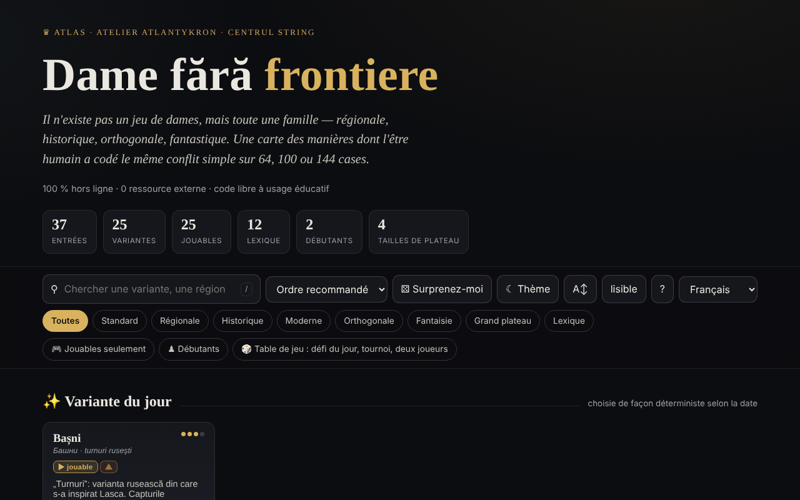

# Dame fără frontiere

[English](README.md) · [Română](README.ro.md) · **Français** · [Italiano](README.it.md) · [Español](README.es.md) · [Português](README.pt.md) · [Deutsch](README.de.md) · [Magyar](README.hu.md)

**Version :** 1.2.2 · **Dernière mise à jour :** 2026-10-19

Langues de l'interface : **Română, English, Français, Italiano, Español, Português (PT), Deutsch, Magyar**

Atlas des variantes du jeu de dames, avec des moteurs de jeu locaux — dans un seul fichier HTML.

**Application en ligne :** https://chiuta.github.io/Dame-fara-frontiere/

## Ce que c'est

Dame fără frontiere (« Dames sans frontières ») est un atlas interactif de la famille des jeux de dames (régionaux, historiques, orthogonaux, fantastiques), sur des plateaux de 64, 100 ou 144 cases. Chaque variante a une fiche avec les règles et des données rapides, et les variantes jouables peuvent être jouées en local contre l'ordinateur. L'application se déclare compagnon du projet « Șah fără frontiere » (« Échecs sans frontières »).

## Fonctionnalités

- 25 variantes (internationale, anglaise, brésilienne, russe, canadienne, italienne, espagnole, portugaise, tchèque, allemande, pool, la variante usuelle RO, thaïlandaise, turque, frisonne, arménienne, Dameo, Croda, Lasca, Bashni, Cheskers, Damath, jeu de dames à qui perd gagne, jeu de dames international à qui perd gagne, dames diagonales) et 12 entrées de lexique (dame, prise obligatoire, prise majoritaire, dame volante, notation numérique, FMJD, promotion, etc.).
- Recherche, tri (ordre recommandé, titre A→Z / Z→A, difficulté croissante / décroissante), filtres « Jouables uniquement » et « Débutants », « Variante du jour » (choisie de façon déterministe d'après la date), « Surprends-moi ».
- Jeu local « Jouer en local · vs IA » : vous choisissez la couleur (Blancs / Noirs) et le niveau (Facile / Moyen / Avancé), avec « Nouvelle partie », « Annuler », « Indice » et « Mode détendu » (prise non obligatoire).
- « ⧉ Copier la partie » et « ⤓ Enregistrer .txt » dans la fenêtre de jeu : un en-tête (variante, plateau, niveau, résultat) et les coups en notation par coordonnées (pas le PDN officiel) ; générés en local.
- Moteurs locaux : générique paramétré, à tours (Bashni, Lasca), à score arithmétique (Damath) et hybride échecs×dames (Cheskers), avec recherche alpha-bêta. L'application avertit par ⚠ des variantes implémentées de manière approximative.
- Export CSV de la liste et citation BibTeX.
- Thème clair/sombre, taille de texte « lisible ».

## Nouveautés (1.1.0) — « Table de jeu »

Elles s'ouvrent depuis le bouton « 🎲 Partie à deux · analyse · quotidien » (dans la fenêtre de jeu) ou « 🎲 Table de jeu » (sur la page principale), dans une boîte de dialogue à cinq onglets :

- **Partie à deux via FFF.p2p** — deux personnes, WebRTC directement entre navigateurs, **sans serveur** : vous échangez manuellement deux codes (copier/coller ou code QR), puis la partie se déroule en « lockstep » : l'hôte (les Blancs) valide et numérote chaque coup, l'invité (les Noirs) ne l'applique qu'après l'écho de l'hôte ; en cas de divergence, l'état complet est renvoyé. Fonctionne pour les variantes de dames jouables (vous choisissez la variante sur l'hôte). Barre « Partie en ligne » avec nulle / nouvelle partie (offre + accepter/refuser), abandon et déconnexion ; en cas de déconnexion, vous pouvez continuer seul depuis la position courante. **Limites :** les NAT symétriques (réseaux mobiles/d'entreprise) ne peuvent pas être traversés sans STUN/TURN ; on peut renseigner un serveur STUN (opt-in, vide par défaut) — l'adresse IP publique parvient alors à ce serveur ; les adversaires voient mutuellement leur adresse IP ; une partie interrompue ne reprend pas après le rechargement de la page ; il n'y a pas de chat.
- **Analyseur local** — « Analyser la position » (évaluation en « pièces », meilleur coup et classement des coups, recherche alpha-bêta avec une limite de temps ≈ 0,7 s, donc la profondeur dépend de l'appareil) et « Analyser la partie » (évalue chaque position, marque les erreurs). Pour Damath et Cheskers, l'évaluation est uniquement matérielle (indiqué dans l'interface). Il ne remplace pas un moteur professionnel ; désactivé en partie en ligne.
- **Défi du jour** — un problème « trouvez le meilleur coup » généré **de façon déterministe d'après la date** (le même pour tout le monde le même jour, sans réseau ; recherche à profondeur fixe, et non limitée par le temps) ; explication en cas de coup erroné (la différence d'évaluation) et série de jours résolus (en local).
- **« ❓ Pourquoi je ne peux pas jouer ? »** — vous touchez une pièce ou une case interdite et l'application dit pourquoi (ce n'est pas votre tour, la pièce appartient à l'adversaire, il existe une prise obligatoire, la pièce n'a aucun coup, le coup poursuit une prise multiple, etc.) ; bouton et touche `W`.
- **Jeu au clavier et annonces audio** — sélection et déplacement avec les flèches/Entrée sur le plateau, touches `L` (dernier coup), `S` (état), `M` (pièces pouvant jouer), `W` (pourquoi je ne peux pas jouer) ; annonces dans une région `aria-live` et, en option, voix (Web Speech, si le navigateur dispose d'une voix dans la langue de la page ; sinon il dit explicitement qu'elle n'est pas disponible).
- **Tournoi Elo local** — Moi, IA facile/moyenne/avancée et d'autres personnes sur le même plateau, toutes rondes (en option aller-retour) ; les parties se jouent sur le plateau ou sont simulées IA–IA à profondeur fixe ; le classement et l'Elo sont recalculés à partir des résultats ; export JSON/CSV et import. L'échelle Elo est **interne** au tournoi, non comparable à celle de la FIDE/FMJD.

Tests : `node tests/fff-r8.test.mjs` (Playwright, réseau bloqué, 2 pages pour le P2P, axe).

## Mode d'emploi

1. Ouvrez la page et parcourez les cartes ; filtrez avec « Jouables uniquement » ou « Débutants », ou cherchez avec `/`.
2. Ouvrez une fiche (résumé, « Règles clés », « Données rapides », « Apparentées »).
3. Si la variante a un moteur, appuyez sur « ▶ Jouer en local · vs IA », choisissez la couleur et le niveau.
4. Sur le plateau, appuyez sur une pièce, puis sur une case en surbrillance. Pour les prises multiples, continuez d'appuyer sur les cases ; la séquence s'applique lorsqu'elle est complète.
5. Utilisez « ↶ Annuler », « 💡 Indice » ou « ↺ Nouvelle partie » ; le « Mode détendu » rend la prise non obligatoire.
6. Raccourcis : `/` met le focus sur la recherche, `R` variante aléatoire, `B` filtre débutants, `T` bascule le thème, `A` taille du texte, `Échap` ferme la fenêtre.
7. « ⤓ Exporter CSV » télécharge la liste ; « ⤓ Citer (BibTeX) » propose la citation.
8. « À propos de cet atlas → » explique le thème, les moteurs et les limites (moteurs didactiques, pas pour une analyse professionnelle).

## Confidentialité et réseau

- **Stockage local :** `localStorage`, clés avec le préfixe `dff_` (thème, mode lisible, variantes explorées, un repère interne) et `dff_r8_` (préférences d'annonces/de voix, tournoi, série quotidienne, cache du problème du jour) ; le kit FFF ajoute la sauvegarde (export/import/suppression) et la fenêtre « Transparence » depuis le numéro de version.
- **Réseau :** dans le code il n'y a ni `fetch`, ni CDN, ni ressource externe (egress déclaré : 0) ; la seule communication est la partie à deux facultative, par WebRTC directement entre les deux joueurs, avec signalisation manuelle (codes échangés par vous) et, uniquement si vous en saisissez un, un serveur STUN ; l'application affirme « 0 ressource externe », sans compte et sans pistage. Les liens vers Buy Me a Coffee, creativecommons.org ou alexio.tf sont de simples hyperliens, ouverts uniquement au clic.

## Exécution locale / hors ligne

Téléchargez `index.html` et ouvrez-le dans le navigateur ; aucune connexion internet n'est nécessaire.

## Licence

Licence MIT — voir le fichier `LICENSE`. L'en-tête de `index.html` et le texte de l'interface indiquent la même licence (une mention antérieure « CC-BY-SA 4.0 » dans l'interface a été supprimée lors de l'audit, 2026-10-11, pour éliminer la contradiction).

## Historique / Changelog

- 1.1.0 — 2026-10-14 (tour 8, C1a) : Table de jeu — partie à deux P2P, analyseur local, défi du jour, « pourquoi je ne peux pas jouer ? », clavier + annonces audio, tournoi Elo local ; kit FFF (core, label, bundle, qr, p2p, tts) avec `app.json` ; CSP : `script-src` avec hachages recalculés (+ `blob:` comme d'habitude pour le kit) ; tests `tests/fff-r8.test.mjs`.
- 1.0.0 — 2026-10-12 : la version et la date de la dernière mise à jour sont affichées dans l'application
- Tour 7 : le plateau en thème sombre a désormais des cases nettement distinctes (contraste ≈ 3:1) et des pièces noires au contour clair ; dans Damath, les opérateurs (+ − × ÷) et les valeurs sur les pièces, ainsi que les lettres des pièces de Cheskers, étaient écrits à ~4,5 px et sont maintenant mis à l'échelle avec la taille du plateau (≈ 13–22 px) ; les titres dans les fenêtres (Règles clés, Données rapides, Raccourcis, etc.) sont des `h3` (hiérarchie correcte, axe `heading-order`) ; le bouton « Jouer contre l'IA » et le sélecteur « Blancs/Noirs » respectent le contraste en thème clair ; le thème par défaut suit `prefers-color-scheme` lorsqu'aucun choix n'est enregistré.
- Ajout de l'export de la partie en cours (copie / .txt) ; CSP : `script-src` par hachage SHA-256 (5 scripts), sans `'unsafe-inline'`. Vérifié : la recherche « englez » laisse 6 cartes visibles (le compteur indique « 6 sur 37 entrées » ; les cartes des étagères masquées restent dans le DOM, mais ne sont pas affichées).
- La recherche ignore les diacritiques, accepte plusieurs mots (tous doivent apparaître), ordonne les résultats avec les correspondances dans le titre en premier et masque les étagères « Variante du jour / Essentielles / Exotiques » tant que la recherche est active ; le compteur indique « N sur 37 entrées ».
- La barre de recherche et de filtres est un repère `role="search"`, et le widget de soutien est `complementary` ; axe-core : 0 violation à 1280 et 360 px.
- Analyse de parties : depuis la 1.1.0 il existe un analyseur local simple (voir « Nouveautés ») ; il reste didactique, pas pour une analyse professionnelle.

## Marques

Les noms de jeux sont des appellations commerciales de leurs détenteurs, utilisées à titre descriptif ; le projet n'est pas affilié à ceux-ci.

## Audit

Audit : 2026-10-10 — vérifié avec Playwright et axe-core (WCAG 2.1 AA, les deux thèmes) ; vérifié dans le code : pas de `fetch`/CDN. Corrigés : la couleur des titres de carte (elle n'héritait pas de la couleur de la page sur les systèmes à thème clair), le contraste du bouton actif en thème clair, une case à cocher décorative pouvant recevoir le focus.

## Auteur

Alexio — Alexandru-Ionuț Chiuță, contact : alexio@trom.tf. L'application mentionne Atlantykron, Editura Tornada et Centrul StrING.

## Résumé
Un atlas de 25 variantes du jeu de dames plus 12 entrées de lexique, avec des adversaires IA locaux (recherche alpha-bêta) pour les variantes jouables. Un seul fichier HTML, interface en roumain, aucune requête externe ; le thème et les variantes explorées sont stockés dans localStorage (préfixe `dff_`). Depuis la 1.1.0 : une « Table de jeu » avec partie à deux en ligne via WebRTC (signalisation manuelle, sans serveur), un analyseur local simple, un problème quotidien déterministe, des explications « pourquoi je ne peux pas jouer ? », le jeu au clavier avec annonces vocales et un tournoi Elo local. Sous licence MIT (voir LICENSE).
