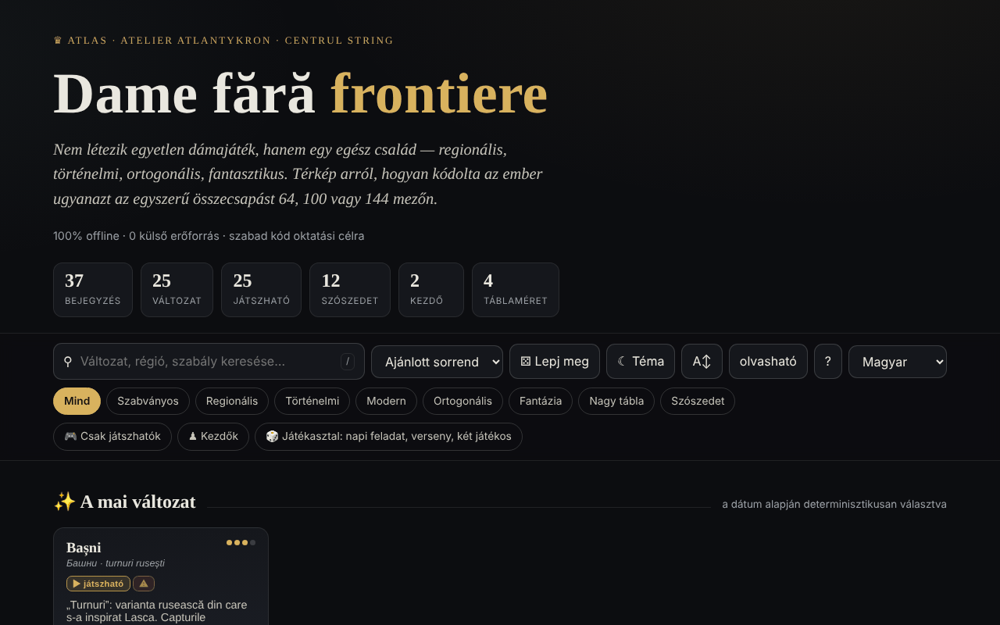

# Dame fără frontiere

[English](README.md) · [Română](README.ro.md) · [Français](README.fr.md) · [Italiano](README.it.md) · [Español](README.es.md) · [Português](README.pt.md) · [Deutsch](README.de.md) · **Magyar**

**Verzió:** 1.2.6 · **Utolsó frissítés:** 2026-10-23

A felület nyelvei: **Română, English, Français, Italiano, Español, Português (PT), Deutsch, Magyar**

A dámajáték változatainak atlasza, helyi játékmotorokkal — egyetlen HTML-fájlban.

**Online alkalmazás:** https://chiuta.github.io/Dame-fara-frontiere/

## Mi ez

A Dame fără frontiere („Dáma határok nélkül”) a dámajátékok családjának (regionális, történelmi, ortogonális, fantasztikus) interaktív atlasza 64, 100 vagy 144 mezős táblákon. Minden változathoz tartozik egy lap szabályokkal és gyors adatokkal, a játszható változatok pedig helyben játszhatók a számítógép ellen. Az alkalmazás magát a „Șah fără frontiere” („Sakk határok nélkül”) projekt társának nyilvánítja.

## Funkciók

- 25 változat (nemzetközi, angol, brazil, orosz, kanadai, olasz, spanyol, portugál, cseh, német, pool, a szokásos RO-változat, thaiföldi, török, fríz, örmény, Dameo, Croda, Lasca, Bashni, Cheskers, Damath, fordított dáma (nyerő-vesztő), nemzetközi fordított dáma, átlós dáma) és 12 lexikonbejegyzés (dáma, kötelező ütés, többségi ütés, repülő dáma, numerikus jelölés, FMJD, átváltozás stb.).
- Keresés, rendezés (ajánlott sorrend, cím A→Z / Z→A, nehézség növekvő / csökkenő), „Csak játszhatók” és „Kezdők” szűrők, „A mai változat” (dátum alapján determinisztikusan kiválasztva), „Lepj meg”.
- Helyi játék „Játék helyben · MI ellen”: kiválasztod a színt (Világos / Sötét) és a szintet (Könnyű / Közepes / Haladó), „Új játék”, „Visszavonás”, „Tipp” és „Lazított mód” (nem kötelező ütés) lehetőséggel.
- „⧉ Játszma másolása” és „⤓ .txt mentése” a játékablakban: fejléc (változat, tábla, szint, eredmény) és a lépések koordinátajelölésben (nem hivatalos PDN); helyben generálva.
- Helyi motorok: általános paraméterezhető, tornyos (Bashni, Lasca), aritmetikai pontszámú (Damath) és sakk×dáma hibrid (Cheskers), alfa-béta kereséssel. Az alkalmazás ⚠ jellel figyelmeztet a közelítőleg megvalósított változatokra.
- A lista CSV-exportja és BibTeX-hivatkozás.
- Világos/sötét téma, „olvasható” szövegméret.

## Újdonságok (1.1.0) — „Játékasztal”

A „🎲 Kétszemélyes játék · elemzés · napi” gombról (a játékablakban) vagy a „🎲 Játékasztal” gombról (a főoldalon) nyílnak meg, öt füles párbeszédablakban:

- **Kétszemélyes játék az FFF.p2p-n keresztül** — két személy, WebRTC közvetlenül a böngészők között, **szerver nélkül**: kézzel cseréltek két kódot (másolás/beillesztés vagy QR-kód), majd a játék „lockstep” módban fut: a házigazda (Világos) érvényesíti és megszámozza minden lépést, a vendég (Sötét) csak a házigazda visszhangja után alkalmazza; bármilyen eltérésnél a teljes állapot újraküldésre kerül. A játszható dámaváltozatoknál működik (a változatot a házigazdán választod). „Online játék” sáv döntetlennel / új játékkal (ajánlat + elfogadás/elutasítás), feladással és szétkapcsolással; szétkapcsolás esetén egyedül folytathatod az aktuális állásból. **Korlátok:** a szimmetrikus NAT-ok (mobil-/vállalati hálózatok) STUN/TURN nélkül nem léphetők át; megadható egy STUN-kiszolgáló (opt-in, alapértelmezetten üres) — ekkor a nyilvános IP-cím eljut ahhoz a kiszolgálóhoz; az ellenfelek látják egymás IP-címét; a megszakadt játszma az oldal újratöltése után nem folytatódik; nincs csevegés.
- **Helyi elemző** — „Állás elemzése” (értékelés „bábukban”, a legjobb lépés és a lépések rangsora, alfa-béta keresés ≈ 0,7 s időkorláttal, így a mélység az eszköztől függ) és „Játszma elemzése” (minden állást értékel, megjelöli a hibákat). A Damath és a Cheskers esetében az értékelés csak anyagi (a felületen jelezve). Nem helyettesít professzionális motort; online játékban letiltva.
- **A nap kihívása** — egy „találd meg a legjobb lépést” feladat, **a dátumból determinisztikusan generálva** (ugyanaz mindenkinek ugyanazon a napon, hálózat nélkül; rögzített mélységű keresés, nem időalapú); magyarázat hibás lépésnél (az értékelési különbség) és a megoldott napok sorozata (helyben).
- **„❓ Miért nem léphetek?”** — megérintesz egy bábut vagy egy nem engedélyezett mezőt, és az alkalmazás megmondja, miért (nem te vagy soron, a bábu az ellenfélé, kötelező ütés van, a bábunak nincs lépése, a lépés egy többszörös ütést folytat stb.); gomb és a `W` billentyű.
- **Billentyűzetes játék és hangos bejelentések** — kijelölés és lépés nyilakkal/Enterrel a táblán, `L` (utolsó lépés), `S` (állás), `M` (léphető bábuk), `W` (miért nem léphetek) billentyűk; bejelentések `aria-live` régióban és opcionálisan hanggal (Web Speech, ha a böngészőben van hang az oldal nyelvén; ellenkező esetben kifejezetten közli, hogy nem érhető el).
- **Helyi Elo-verseny** — Én, könnyű/közepes/haladó MI és más személyek ugyanannál a tábla mellett, körmérkőzés (opcionálisan oda-vissza); a mérkőzések a táblán játszhatók, vagy MI–MI között rögzített mélységgel szimulálhatók; a rangsor és az Elo az eredményekből újraszámolódik; JSON/CSV-export és -import. Az Elo-skála a versenyen **belüli**, nem összehasonlítható a FIDE/FMJD-vel.

Tesztek: `node tests/fff-r8.test.mjs` (Playwright, letiltott hálózat, 2 oldal a P2P-hez, axe).

## Használati útmutató

1. Nyisd meg az oldalt, és böngészd a kártyákat; szűrj a „Csak játszhatók” vagy a „Kezdők” szűrővel, vagy keress a `/` billentyűvel.
2. Nyiss meg egy lapot (összefoglaló, „Kulcsszabályok”, „Gyors adatok”, „Rokon változatok”).
3. Ha a változatnak van motorja, nyomd meg a „▶ Játék helyben · MI ellen” gombot, válaszd ki a színt és a szintet.
4. A táblán nyomj meg egy bábut, majd egy kiemelt mezőt. Többszörös ütésnél folytasd a mezők megnyomását; a sorozat akkor kerül alkalmazásra, ha teljes.
5. Használd a „↶ Visszavonás”, „💡 Tipp” vagy „↺ Új játék” gombokat; a „Lazított mód” nem kötelezővé teszi az ütést.
6. Billentyűparancsok: `/` a keresésre fókuszál, `R` véletlen változat, `B` kezdő szűrő, `T` témaváltás, `A` szövegméret, `Esc` bezárja az ablakot.
7. A „⤓ CSV exportálása” letölti a listát; a „⤓ Hivatkozás (BibTeX)” felkínálja a hivatkozást.
8. Az „Erről az atlaszról →” elmagyarázza a témát, a motorokat és a korlátokat (oktató jellegű motorok, nem professzionális elemzéshez).

## Adatvédelem és hálózat

- **Helyi tárolás:** `localStorage`, `dff_` előtagú kulcsok (téma, olvasható mód, felfedezett változatok, egy belső jelölő) és `dff_r8_` előtagú kulcsok (bejelentési/hang beállítások, verseny, napi sorozat, a napi feladat gyorsítótára); az FFF-készlet biztonsági mentést (export/import/törlés) és a verziószámból megnyíló „Átláthatóság” ablakot ad hozzá.
- **Hálózat:** a kódban nincs `fetch`, CDN vagy külső erőforrás (deklarált kimenő forgalom: 0); az egyetlen kommunikáció az opcionális kétszemélyes játék, WebRTC-vel közvetlenül a két játékos között, kézi jelzéssel (általatok cserélt kódok) és – csak ha megadsz egyet – egy STUN-kiszolgálóval; az alkalmazás kijelenti: „0 külső erőforrás”, fiók és követés nélkül. A Buy Me a Coffee, a creativecommons.org vagy az alexio.tf felé mutató hivatkozások egyszerű hiperhivatkozások, csak kattintásra nyílnak meg.

## Helyi / offline futtatás

Töltsd le az `index.html` fájlt, és nyisd meg böngészőben; nem igényel internetet.

## Licenc

MIT-licenc — lásd a `LICENSE` fájlt. Az `index.html` fejléce és a felület szövege ugyanazt a licencet jelzi (a felületen korábban szereplő „CC-BY-SA 4.0” említést az auditkor, 2026-10-11-én eltávolították az ellentmondás megszüntetése érdekében).

## Előzmények / Changelog

- 1.2.5 — 2026-10-22: fff-kit 1.1.4: érintési célpontok és minimális szövegméret
- 1.2.4 — 2026-10-22: fff-kit 1.1.2: PBKDF2 600 000 iteráció, clickjacking elleni védelem
- 1.2.3 — 2026-10-22: mobil és kisegítő finomítások: legalább 12 px-es szöveg és legalább 24 px-es érintési felületek. látható billentyűzetfókusz minden vezérlőn.
- 1.1.0 — 2026-10-14 (8. kör, C1a): Játékasztal — kétszemélyes P2P-játék, helyi elemző, a nap kihívása, „miért nem léphetek?”, billentyűzet + hangos bejelentések, helyi Elo-verseny; FFF-készlet (core, label, bundle, qr, p2p, tts) `app.json`-nal; CSP: `script-src` újraszámolt hash-ekkel (+ `blob:` a készlethez szokás szerint); tesztek: `tests/fff-r8.test.mjs`.
- 1.0.0 — 2026-10-12: a verzió és az utolsó frissítés dátuma megjelenik az alkalmazásban
- 7. kör: a tábla sötét témában mostantól jól elkülönülő mezőkkel (kontraszt ≈ 3:1) és világos körvonalú fekete bábukkal rendelkezik; a Damathban az operátorok (+ − × ÷) és a bábukon lévő értékek, valamint a Cheskers bábuinak betűi ~4,5 px-esek voltak, most a tábla méretével skálázódnak (≈ 13–22 px); az ablakok címsorai (Kulcsszabályok, Gyors adatok, Billentyűparancsok stb.) `h3` elemek (helyes hierarchia, axe `heading-order`); a „Játék MI ellen” gomb és a „Világos/Sötét” választó világos témában is betartja a kontrasztot; az alapértelmezett téma a `prefers-color-scheme` értéket követi, ha nincs mentett választás.
- Hozzáadva az aktuális játszma exportja (másolás / .txt); CSP: `script-src` SHA-256 hash alapján (5 szkript), `'unsafe-inline'` nélkül. Ellenőrizve: az „englez” keresés 6 látható kártyát hagy (a számláló „6 / 37 bejegyzés” értéket mutat; az elrejtett polcok kártyái a DOM-ban maradnak, de nem jelennek meg).
- A keresés figyelmen kívül hagyja az ékezeteket, több szót is elfogad (mindnek szerepelnie kell), a címben találatot adó eredményeket előre sorolja, és a keresés aktív ideje alatt elrejti az „A mai változat / Alapvetők / Egzotikusak” polcokat; a számláló „N / 37 bejegyzés” értéket mutat.
- A keresési és szűrősáv `role="search"` tájékozódási pont, a támogató widget pedig `complementary`; axe-core: 0 szabálysértés 1280 és 360 px-en.
- Játszmaelemzés: az 1.1.0 óta van egy egyszerű helyi elemző (lásd „Újdonságok”); továbbra is oktató jellegű, nem professzionális elemzéshez.

## Védjegyek

A játékok nevei tulajdonosaik kereskedelmi megnevezései, leíró jelleggel használva; a projekt nem áll kapcsolatban velük.

## Audit

Audit: 2026-10-10 — Playwrighttal és axe-core-ral ellenőrizve (WCAG 2.1 AA, mindkét téma); a kódban ellenőrizve: nincs `fetch`/CDN. Javítva: a kártyacímek színe (világos témájú rendszereken nem örökölte az oldal színét), az aktív gomb kontrasztja világos témában, egy dekoratív, fókuszálható jelölőnégyzet.

## Szerző

Alexio — Alexandru-Ionuț Chiuță, kapcsolat: alexio@trom.tf. Az alkalmazás megemlíti az Atlantykront, az Editura Tornadát és a Centrul StrINGet.

## Összefoglaló
A dámajáték 25 változatának atlasza, plusz 12 lexikonbejegyzés, a játszható változatokhoz helyi MI-ellenfelekkel (alfa-béta keresés). Egyetlen HTML-fájl, román nyelvű felület, külső kérések nélkül; a téma és a felfedezett változatok a localStorage-ban tárolódnak (`dff_` előtag). Az 1.1.0 óta: „Játékasztal” kétszemélyes online játékkal WebRTC-n keresztül (kézi jelzés, szerver nélkül), egy egyszerű helyi elemző, egy determinisztikus napi feladat, „miért nem léphetek?” magyarázatok, billentyűzetes játék kimondott bejelentésekkel és egy helyi Elo-verseny. MIT-licenc (lásd LICENSE).
