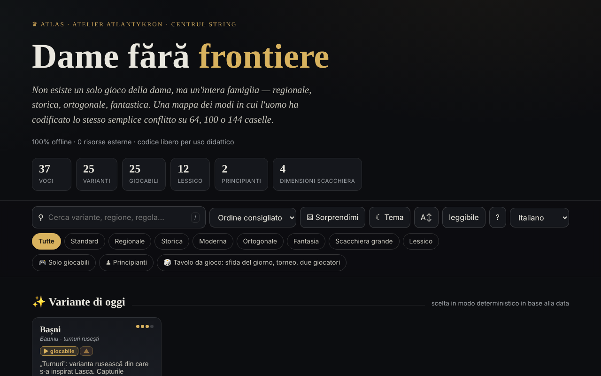

# Dame fără frontiere

[English](README.md) · [Română](README.ro.md) · [Français](README.fr.md) · **Italiano** · [Español](README.es.md) · [Português](README.pt.md) · [Deutsch](README.de.md) · [Magyar](README.hu.md)

**Versione:** 2.2.0 · **Ultimo aggiornamento:** 2026-10-27

Lingue dell'interfaccia: **Română, English, Français, Italiano, Español, Português (PT), Deutsch, Magyar**

Atlante delle varianti della dama, con motori di gioco locali — in un unico file HTML.

**Applicazione online:** https://chiuta.github.io/Dame-fara-frontiere/

## Che cos'è

Dame fără frontiere («Dama senza frontiere») è un atlante interattivo della famiglia dei giochi di dama (regionali, storici, ortogonali, fantastici), su scacchiere di 64, 100 o 144 caselle. Ogni variante ha una scheda con regole e dati rapidi, e le varianti giocabili si possono giocare in locale contro il computer. L'applicazione si dichiara compagna del progetto «Șah fără frontiere» («Scacchi senza frontiere»).

## Funzioni

- 25 varianti (internazionale, inglese, brasiliana, russa, canadese, italiana, spagnola, portoghese, ceca, tedesca, pool, la variante consueta RO, thailandese, turca, frisone, armena, Dameo, Croda, Lasca, Bashni, Cheskers, Damath, dama perdente, dama internazionale perdente, dama diagonale) e 12 voci di lessico (dama, presa obbligatoria, presa di maggioranza, dama volante, notazione numerica, FMJD, promozione ecc.).
- Ricerca, ordinamento (ordine consigliato, titolo A→Z / Z→A, difficoltà crescente / decrescente), filtri «Solo giocabili» e «Principianti», «Variante di oggi» (scelta in modo deterministico in base alla data), «Sorprendimi».
- Gioco locale «Gioca in locale · vs IA»: scegli il colore (Bianchi / Neri) e il livello (Facile / Medio / Avanzato), con «Nuova partita», «Annulla», «Suggerimento» e «Modalità rilassata» (presa non obbligatoria).
- «⧉ Copia la partita» e «⤓ Salva .txt» nella finestra di gioco: un'intestazione (variante, scacchiera, livello, risultato) e le mosse in notazione per coordinate (non PDN ufficiale); generate in locale.
- Motori locali: generico parametrizzato, a torri (Bashni, Lasca), a punteggio aritmetico (Damath) e ibrido scacchi×dama (Cheskers), con ricerca alfa-beta. L'applicazione avvisa con ⚠ le varianti implementate in modo approssimativo.
- Esportazione CSV dell'elenco e citazione BibTeX.
- Tema chiaro/scuro, dimensione del testo «leggibile».

## Novità (1.1.0) — «Tavolo da gioco»

### 1.2.4 — 2026-10-22
- fff-kit 1.1.2: PBKDF2 600.000 iterazioni, protezione anti-clickjacking

Si aprono dal pulsante «🎲 Partita in due · analisi · giornaliero» (nella finestra di gioco) o «🎲 Tavolo da gioco» (nella pagina principale), in una finestra di dialogo con cinque schede:

- **Partita in due tramite FFF.p2p** — due persone, WebRTC direttamente tra browser, **senza server**: scambi manualmente due codici (copia/incolla o codice QR), poi la partita procede in «lockstep»: l'host (i Bianchi) convalida e numera ogni mossa, l'ospite (i Neri) la applica solo dopo l'eco dell'host; a ogni divergenza viene rinviato lo stato completo. Funziona per le varianti di dama giocabili (scegli la variante sull'host). Barra «Partita online» con patta / nuova partita (offerta + accetta/rifiuta), abbandono e disconnessione; alla disconnessione puoi continuare da solo dalla posizione corrente. **Limiti:** i NAT simmetrici (reti mobili/aziendali) non possono essere attraversati senza STUN/TURN; si può inserire un server STUN (opt-in, vuoto per impostazione predefinita) — in tal caso l'indirizzo IP pubblico arriva a quel server; gli avversari vedono reciprocamente il proprio indirizzo IP; una partita interrotta non riprende dopo il ricaricamento della pagina; non c'è chat.
- **Analizzatore locale** — «Analizza la posizione» (valutazione in «pezzi», la mossa migliore e la classifica delle mosse, ricerca alfa-beta con limite di tempo ≈ 0,7 s, quindi la profondità dipende dal dispositivo) e «Analizza la partita» (valuta ogni posizione, segna gli errori). Per Damath e Cheskers la valutazione è solo materiale (indicato nell'interfaccia). Non sostituisce un motore professionale; disattivato nella partita online.
- **Sfida del giorno** — un problema «trova la mossa migliore» generato **in modo deterministico dalla data** (lo stesso per tutti nello stesso giorno, senza rete; ricerca a profondità fissa, non a tempo); spiegazione per la mossa sbagliata (la differenza di valutazione) e serie di giorni risolti (in locale).
- **«❓ Perché non posso muovere?»** — tocchi un pezzo o una casella non consentita e l'applicazione dice perché (non è il tuo turno, il pezzo è dell'avversario, esiste una presa obbligatoria, il pezzo non ha mosse, la mossa prosegue una presa multipla ecc.); pulsante e tasto `W`.
- **Gioco da tastiera e annunci audio** — selezione e mossa con frecce/Invio sulla scacchiera, tasti `L` (ultima mossa), `S` (stato), `M` (pezzi che possono muovere), `W` (perché non posso muovere); annunci in una regione `aria-live` e, facoltativamente, voce (Web Speech, se il browser ha una voce nella lingua della pagina; altrimenti dice esplicitamente che non è disponibile).
- **Torneo Elo locale** — Io, IA facile/media/avanzata e altre persone alla stessa scacchiera, girone all'italiana (facoltativamente andata e ritorno); le partite si giocano sulla scacchiera o si simulano IA–IA a profondità fissa; la classifica e l'Elo vengono ricalcolati dai risultati; esportazione JSON/CSV e importazione. La scala Elo è **interna** al torneo, non confrontabile con la FIDE/FMJD.

Test: `node tests/fff-r8.test.mjs` (Playwright, rete bloccata, 2 pagine per il P2P, axe).

## Guida all'uso

1. Apri la pagina e scorri le schede; filtra con «Solo giocabili» o «Principianti», oppure cerca con `/`.
2. Apri una scheda (riepilogo, «Regole chiave», «Dati rapidi», «Affini»).
3. Se la variante ha un motore, premi «▶ Gioca in locale · vs IA», scegli il colore e il livello.
4. Sulla scacchiera premi un pezzo, poi una casella evidenziata. Per le prese multiple continua a premere le caselle; la sequenza viene applicata quando è completa.
5. Usa «↶ Annulla», «💡 Suggerimento» o «↺ Nuova partita»; la «Modalità rilassata» rende la presa non obbligatoria.
6. Scorciatoie: `/` mette il focus sulla ricerca, `R` variante casuale, `B` filtro principianti, `T` cambia il tema, `A` dimensione del testo, `Esc` chiude la finestra.
7. «⤓ Esporta CSV» scarica l'elenco; «⤓ Cita (BibTeX)» offre la citazione.
8. «Informazioni su questo atlante →» spiega il tema, i motori e i limiti (motori didattici, non per analisi professionale).

## Privacy e rete

- **Archiviazione locale:** `localStorage`, chiavi con il prefisso `dff_` (tema, modalità leggibile, varianti esplorate, un indicatore interno) e `dff_r8_` (preferenze di annunci/voce, torneo, serie giornaliera, cache del problema del giorno); il kit FFF aggiunge la copia di riserva (esportazione/importazione/cancellazione) e la finestra «Trasparenza» dal numero di versione.
- **Rete:** nel codice non ci sono `fetch`, CDN né risorse esterne (egress dichiarato: 0); l'unica comunicazione è la partita in due facoltativa, tramite WebRTC direttamente tra i due giocatori, con segnalazione manuale (codici scambiati da voi) e, solo se ne inserisci uno, un server STUN; l'applicazione afferma «0 risorse esterne», senza account e senza tracciamento. I link a Buy Me a Coffee, creativecommons.org o alexio.tf sono semplici collegamenti ipertestuali, aperti solo al clic.

## Esecuzione locale / offline

Scarica `index.html` e aprilo nel browser; non richiede internet.

## Licenza

Licenza MIT — vedi il file `LICENSE`. L'intestazione di `index.html` e il testo dell'interfaccia indicano la stessa licenza (una precedente menzione «CC-BY-SA 4.0» nell'interfaccia è stata rimossa durante l'audit, 2026-10-11, per eliminare la contraddizione).

## Cronologia / Changelog

- 1.2.5 — 2026-10-22: fff-kit 1.1.4: target touch e dimensione minima del testo
- 1.2.3 — 2026-10-22: rifiniture per mobile e accessibilità: testo di almeno 12 px e aree tattili di almeno 24 px. focus da tastiera visibile su ogni controllo.
- 1.1.0 — 2026-10-14 (giro 8, C1a): Tavolo da gioco — partita in due P2P, analizzatore locale, sfida del giorno, «perché non posso muovere?», tastiera + annunci audio, torneo Elo locale; kit FFF (core, label, bundle, qr, p2p, tts) con `app.json`; CSP: `script-src` con hash ricalcolati (+ `blob:` come di consueto per il kit); test `tests/fff-r8.test.mjs`.
- 1.0.0 — 2026-10-12: la versione e la data dell'ultimo aggiornamento sono mostrate nell'applicazione
- Giro 7: la scacchiera nel tema scuro ha ora caselle chiaramente distinte (contrasto ≈ 3:1) e pezzi neri con contorno chiaro; in Damath gli operatori (+ − × ÷) e i valori sui pezzi, così come le lettere dei pezzi di Cheskers, erano scritti a ~4,5 px e ora si ridimensionano con la dimensione della scacchiera (≈ 13–22 px); i titoli nelle finestre (Regole chiave, Dati rapidi, Scorciatoie ecc.) sono `h3` (gerarchia corretta, axe `heading-order`); il pulsante «Gioca contro l'IA» e il selettore «Bianchi/Neri» rispettano il contrasto nel tema chiaro; il tema predefinito segue `prefers-color-scheme` quando non c'è una scelta salvata.
- Aggiunta l'esportazione della partita corrente (copia / .txt); CSP: `script-src` tramite hash SHA-256 (5 script), senza `'unsafe-inline'`. Verificato: la ricerca «englez» lascia visibili 6 schede (il contatore mostra «6 di 37 voci»; le schede negli scaffali nascosti restano nel DOM, ma non vengono mostrate).
- La ricerca ignora i diacritici, accetta più parole (devono comparire tutte), ordina i risultati con le corrispondenze nel titolo per prime e nasconde gli scaffali «Variante di oggi / Essenziali / Esotiche» finché la ricerca è attiva; il contatore mostra «N di 37 voci».
- La barra di ricerca e filtri è un punto di riferimento `role="search"`, e il widget di sostegno è `complementary`; axe-core: 0 violazioni a 1280 e 360 px.
- Analisi delle partite: dalla 1.1.0 esiste un semplice analizzatore locale (vedi «Novità»); resta didattico, non per analisi professionale.

## Marchi

I nomi dei giochi sono denominazioni commerciali dei rispettivi titolari, usate a scopo descrittivo; il progetto non è affiliato con essi.

## Audit

Audit: 2026-10-10 — verificato con Playwright e axe-core (WCAG 2.1 AA, entrambi i temi); verificato nel codice: nessun `fetch`/CDN. Corretti: il colore dei titoli delle schede (non ereditava il colore della pagina sui sistemi con tema chiaro), il contrasto sul pulsante attivo nel tema chiaro, una casella di controllo decorativa attivabile con il focus.

## Autore

Alexio — Alexandru-Ionuț Chiuță, contatto: alexio@trom.tf. L'applicazione menziona Atlantykron, Editura Tornada e Centrul StrING.

## Riepilogo
Un atlante di 25 varianti della dama più 12 voci di lessico, con avversari IA locali (ricerca alfa-beta) per le varianti giocabili. Un unico file HTML, interfaccia in rumeno, nessuna richiesta esterna; il tema e le varianti esplorate sono salvati in localStorage (prefisso `dff_`). Dalla 1.1.0: un «Tavolo da gioco» con partita in due online tramite WebRTC (segnalazione manuale, senza server), un semplice analizzatore locale, un problema giornaliero deterministico, spiegazioni «perché non posso muovere?», gioco da tastiera con annunci vocali e un torneo Elo locale. Con licenza MIT (vedi LICENSE).
