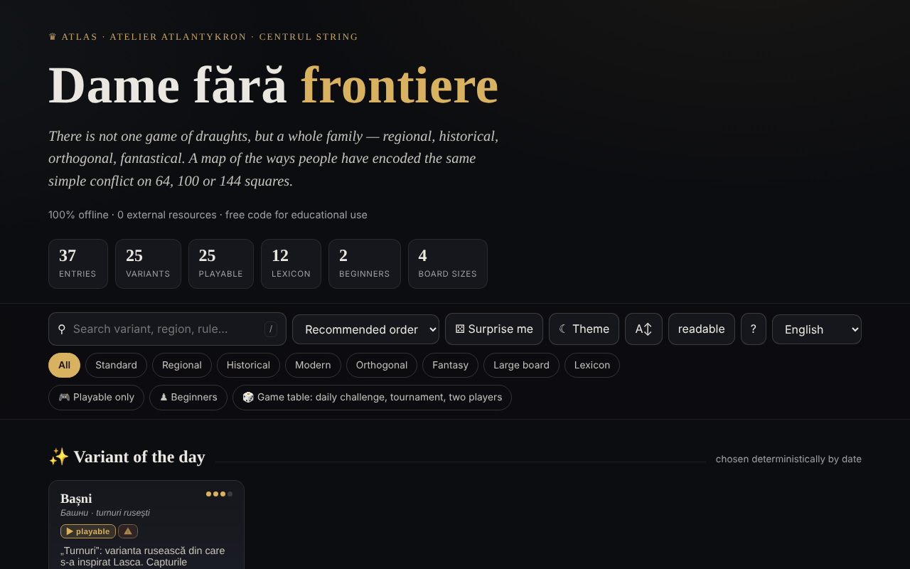

# Dame fără frontiere

**English** · [Română](README.ro.md) · [Français](README.fr.md) · [Italiano](README.it.md) · [Español](README.es.md) · [Português](README.pt.md) · [Deutsch](README.de.md) · [Magyar](README.hu.md)

**Version:** 1.2.7 · **Last updated:** 2026-10-23

Interface languages: **Română, English, Français, Italiano, Español, Português (PT), Deutsch, Magyar**

An atlas of draughts/checkers variants, with local game engines — in a single HTML file.

**Live app:** https://chiuta.github.io/Dame-fara-frontiere/

## What it is

Dame fără frontiere ("Draughts without borders") is an interactive atlas of the draughts family of games (regional, historical, orthogonal, fantasy), on boards of 64, 100 or 144 squares. Each variant has a sheet with rules and quick facts, and the playable variants can be played locally against the computer. The app declares itself a companion to the "Șah fără frontiere" ("Chess without borders") project.

## Features

- 25 variants (international, English, Brazilian, Russian, Canadian, Italian, Spanish, Portuguese, Czech, German, pool, the usual RO variant, Thai, Turkish, Frisian, Armenian, Dameo, Croda, Lasca, Bashni, Cheskers, Damath, anti-draughts, international anti-draughts, diagonal draughts) and 12 lexicon entries (king, mandatory capture, majority capture, flying king, numeric notation, FMJD, promotion etc.).
- Search, sorting (recommended order, title A→Z / Z→A, difficulty ascending / descending), the "Playable only" and "Beginners" filters, "Today's variant" (chosen deterministically by date), "Surprise me".
- Local game "Play locally · vs AI": you choose the colour (White / Black) and the level (Easy / Medium / Advanced), with "New game", "Undo", "Hint" and "Relaxed mode" (non-mandatory capture).
- "⧉ Copy the game" and "⤓ Save .txt" in the game window: a header (variant, board, level, result) and the moves in coordinate notation (not official PDN); generated locally.
- Local engines: generic parameterised, tower-based (Bashni, Lasca), arithmetic-score (Damath) and a chess×draughts hybrid (Cheskers), with alpha-beta search. The app warns with ⚠ about variants implemented approximately.
- CSV export of the list and BibTeX citation.
- Light/dark theme, "legible" text size.

## New features (1.1.0) — "Game table"

They open from the "🎲 Two-player game · analysis · daily" button (in the game window) or "🎲 Game table" (on the main page), in a dialog with five tabs:

- **Two-player game via FFF.p2p** — two people, WebRTC directly between browsers, **no server**: you exchange two codes manually (copy/paste or QR code), then the game runs in "lockstep": the host (White) validates and numbers each move, the guest (Black) applies it only after the host's echo; on any divergence the full state is resent. It works for the playable draughts variants (you choose the variant on the host). An "Online game" bar with draw / new game (offer + accept/decline), resignation and disconnection; on disconnection you can continue alone from the current position. **Limits:** symmetric NATs (mobile/corporate networks) cannot be traversed without STUN/TURN; a STUN server can be filled in (opt-in, empty by default) — then the public IP address reaches that server; opponents see each other's IP address; an interrupted game does not resume after reloading the page; there is no chat.
- **Local analyser** — "Analyse position" (evaluation in "pieces", the best move and the ranking of moves, alpha-beta search with a time limit of ≈ 0.7 s, so the depth depends on the device) and "Analyse game" (evaluates every position, marks the mistakes). For Damath and Cheskers the evaluation is material only (stated in the interface). It does not replace a professional engine; disabled in online play.
- **Daily challenge** — a "find the best move" problem generated **deterministically from the date** (the same for everyone on the same day, without a network; fixed-depth search, not time-based); an explanation for a wrong move (the evaluation difference) and a streak of solved days (local).
- **"❓ Why can't I move?"** — you tap a piece or a disallowed square and the app says why (it is not your turn, the piece is the opponent's, there is a mandatory capture, the piece has no moves, the move continues a multiple capture etc.); button and the `W` key.
- **Keyboard play and audio announcements** — selection and moves with arrows/Enter on the board, the keys `L` (last move), `S` (status), `M` (pieces that can move), `W` (why can't I move); announcements in an `aria-live` region and, optionally, voice (Web Speech, if the browser has a voice in the page's language; otherwise it says explicitly that it is not available).
- **Local Elo tournament** — Me, easy/medium/advanced AI and other people at the same board, round-robin (optionally home-and-away); matches are played on the board or simulated AI–AI with fixed depth; the standings and the Elo are recalculated from the results; JSON/CSV export and import. The Elo scale is **internal** to the tournament, not comparable with FIDE/FMJD.

Tests: `node tests/fff-r8.test.mjs` (Playwright, network blocked, 2 pages for P2P, axe).

## User guide

1. Open the page and browse the cards; filter with "Playable only" or "Beginners", or search with `/`.
2. Open a sheet (summary, "Key rules", "Quick facts", "Related").
3. If the variant has an engine, press "▶ Play locally · vs AI", choose the colour and the level.
4. On the board press a piece, then a highlighted square. For multiple captures keep pressing the squares; the sequence is applied when complete.
5. Use "↶ Undo", "💡 Hint" or "↺ New game"; "Relaxed mode" makes capture non-mandatory.
6. Shortcuts: `/` focuses the search, `R` random variant, `B` beginners filter, `T` toggles the theme, `A` text size, `Esc` closes the window.
7. "⤓ Export CSV" downloads the list; "⤓ Cite (BibTeX)" offers the citation.
8. "About this atlas →" explains the theme, the engines and the limits (didactic engines, not for professional analysis).

## Privacy and network

- **Local storage:** `localStorage`, keys with the prefix `dff_` (theme, legible mode, explored variants, an internal marker) and `dff_r8_` (announcement/voice preferences, tournament, daily streak, the cache of the daily problem); the FFF kit adds backup (export/import/delete) and the "Transparency" window from the version number.
- **Network:** in the code there is no `fetch`, CDN or external resource (declared egress: 0); the only communication is the optional two-player game, via WebRTC directly between the two players, with manual signalling (codes you exchange) and, only if you enter one, a STUN server; the app states "0 external resources", no account and no tracking. The links to Buy Me a Coffee, creativecommons.org or alexio.tf are plain hyperlinks, opened only on click.

## Running locally / offline

Download `index.html` and open it in a browser; it does not require internet.

## License

MIT License — see the `LICENSE` file. The header in `index.html` and the text in the interface indicate the same license (an earlier "CC-BY-SA 4.0" mention in the interface was removed during the audit, 2026-10-11, to eliminate the contradiction).

## History / Changelog

- 1.2.5 — 2026-10-22: fff-kit 1.1.4: touch targets and minimum text size
- 1.2.4 — 2026-10-22: fff-kit 1.1.2: PBKDF2 600,000 iterations, anti-clickjacking protection
- 1.2.3 — 2026-10-22: mobile and accessibility polish: text at least 12 px and touch targets at least 24 px. visible keyboard focus on every control.
- 1.1.0 — 2026-10-14 (round 8, C1a): Game table — two-player P2P game, local analyser, daily challenge, "why can't I move?", keyboard + audio announcements, local Elo tournament; FFF kit (core, label, bundle, qr, p2p, tts) with `app.json`; CSP: `script-src` with recalculated hashes (+ `blob:` as usual for the kit); tests `tests/fff-r8.test.mjs`.
- 1.0.0 — 2026-10-12: the version and the date of the last update are shown in the app
- Round 7: the board in the dark theme now has clearly distinct squares (contrast ≈ 3:1) and black pieces with a light outline; in Damath the operators (+ − × ÷) and the values on the pieces, as well as the piece letters in Cheskers, were written at ~4.5 px and are now scaled with the board size (≈ 13–22 px); the headings in the windows (Key rules, Quick facts, Shortcuts etc.) are `h3` (correct hierarchy, axe `heading-order`); the "Play against AI" button and the "White/Black" selector respect contrast in the light theme; the default theme follows `prefers-color-scheme` when there is no saved choice.
- Added export of the current game (copy / .txt); CSP: `script-src` by SHA-256 hash (5 scripts), without `'unsafe-inline'`. Verified: searching "englez" leaves 6 cards visible (the counter shows "6 of 37 entries"; the cards in the hidden shelves remain in the DOM, but are not displayed).
- Search ignores diacritics, accepts several words (all must appear), orders the results with title matches first and hides the "Today's variant / Essentials / Exotic" shelves while the search is active; the counter shows "N of 37 entries".
- The search and filter bar is a `role="search"` landmark, and the support widget is `complementary`; axe-core: 0 violations at 1280 and 360 px.
- Game analysis: since 1.1.0 there is a simple local analyser (see "New features"); it remains didactic, not for professional analysis.

## Trademarks

The names of games are trade names of their holders, used descriptively; the project is not affiliated with them.

## Audit

Audit: 2026-10-10 — checked with Playwright and axe-core (WCAG 2.1 AA, both themes); verified in the code: no `fetch`/CDN. Corrected: the colour of the card titles (it did not inherit the page colour on systems with a light theme), contrast on the active button in the light theme, a decorative focusable checkbox.

## Author

Alexio — Alexandru-Ionuț Chiuță, contact: alexio@trom.tf. The app mentions Atlantykron, Editura Tornada and Centrul StrING.
