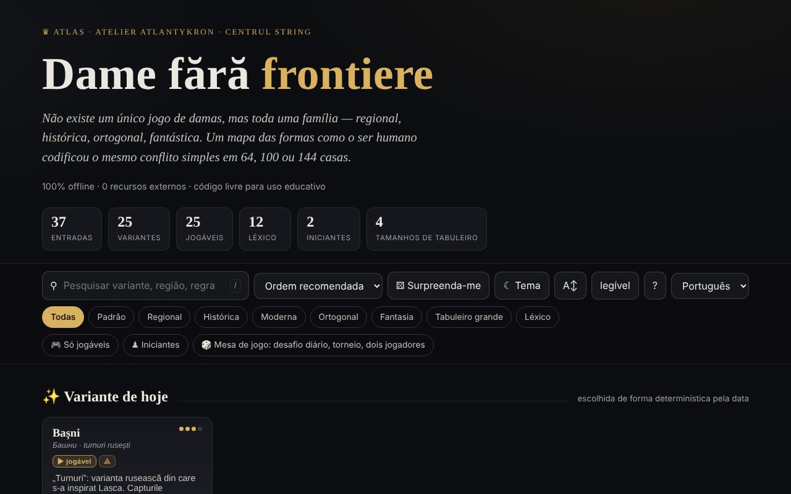

# Dame fără frontiere

[English](README.md) · [Română](README.ro.md) · [Français](README.fr.md) · [Italiano](README.it.md) · [Español](README.es.md) · **Português** · [Deutsch](README.de.md) · [Magyar](README.hu.md)

**Versão:** 1.2.4 · **Última atualização:** 2026-10-22

Idiomas da interface: **Română, English, Français, Italiano, Español, Português (PT), Deutsch, Magyar**

Atlas das variantes do jogo de damas, com motores de jogo locais — num único ficheiro HTML.

**Aplicação online:** https://chiuta.github.io/Dame-fara-frontiere/

## O que é

Dame fără frontiere («Damas sem fronteiras») é um atlas interativo da família de jogos de damas (regionais, históricos, ortogonais, fantásticos), em tabuleiros de 64, 100 ou 144 casas. Cada variante tem uma ficha com regras e dados rápidos, e as variantes jogáveis podem ser jogadas localmente contra o computador. A aplicação declara-se companheira do projeto «Șah fără frontiere» («Xadrez sem fronteiras»).

## Funcionalidades

- 25 variantes (internacional, inglesa, brasileira, russa, canadiana, italiana, espanhola, portuguesa, checa, alemã, pool, a variante habitual RO, tailandesa, turca, frísia, arménia, Dameo, Croda, Lasca, Bashni, Cheskers, Damath, damas à perder, damas internacionais à perder, damas diagonais) e 12 entradas de léxico (dama, captura obrigatória, captura maioritária, dama voadora, notação numérica, FMJD, promoção, etc.).
- Pesquisa, ordenação (ordem recomendada, título A→Z / Z→A, dificuldade crescente / decrescente), filtros «Apenas jogáveis» e «Principiantes», «Variante de hoje» (escolhida de forma determinista pela data), «Surpreende-me».
- Jogo local «Jogar localmente · vs IA»: escolhe a cor (Brancas / Pretas) e o nível (Fácil / Médio / Avançado), com «Novo jogo», «Anular», «Dica» e «Modo descontraído» (captura não obrigatória).
- «⧉ Copiar a partida» e «⤓ Guardar .txt» na janela de jogo: um cabeçalho (variante, tabuleiro, nível, resultado) e as jogadas em notação por coordenadas (não é PDN oficial); geradas localmente.
- Motores locais: genérico parametrizado, de torres (Bashni, Lasca), de pontuação aritmética (Damath) e híbrido xadrez×damas (Cheskers), com pesquisa alfa-beta. A aplicação avisa com ⚠ as variantes implementadas de forma aproximada.
- Exportação CSV da lista e citação BibTeX.
- Tema claro/escuro, tamanho de texto «legível».

## Novidades (1.1.0) — «Mesa de jogo»

Abrem-se a partir do botão «🎲 Jogo a dois · análise · diário» (na janela de jogo) ou «🎲 Mesa de jogo» (na página principal), numa caixa de diálogo com cinco separadores:

- **Jogo a dois através de FFF.p2p** — duas pessoas, WebRTC diretamente entre navegadores, **sem servidor**: trocam manualmente dois códigos (copiar/colar ou código QR), e depois o jogo decorre em «lockstep»: o anfitrião (as Brancas) valida e numera cada jogada, o convidado (as Pretas) só a aplica após o eco do anfitrião; perante qualquer divergência, o estado completo é reenviado. Funciona para as variantes de damas jogáveis (escolhe a variante no anfitrião). Barra «Jogo online» com empate / novo jogo (oferta + aceitar/recusar), desistência e desligação; ao desligar, pode continuar sozinho a partir da posição atual. **Limites:** os NAT simétricos (redes móveis/empresariais) não podem ser atravessados sem STUN/TURN; pode preencher-se um servidor STUN (opt-in, vazio por predefinição) — nesse caso o endereço IP público chega a esse servidor; os adversários veem mutuamente o endereço IP; um jogo interrompido não é retomado após recarregar a página; não há chat.
- **Analisador local** — «Analisar a posição» (avaliação em «peças», a melhor jogada e a classificação das jogadas, pesquisa alfa-beta com limite de tempo ≈ 0,7 s, pelo que a profundidade depende do dispositivo) e «Analisar a partida» (avalia cada posição, assinala os erros). Para Damath e Cheskers a avaliação é apenas material (indicado na interface). Não substitui um motor profissional; desativado no jogo online.
- **Desafio do dia** — um problema «encontre a melhor jogada» gerado **de forma determinista a partir da data** (o mesmo para todos no mesmo dia, sem rede; pesquisa de profundidade fixa, não por tempo); explicação perante a jogada errada (a diferença de avaliação) e sequência de dias resolvidos (localmente).
- **«❓ Porque não posso jogar?»** — toca numa peça ou numa casa não permitida e a aplicação diz porquê (não é a sua vez, a peça é do adversário, existe uma captura obrigatória, a peça não tem jogadas, a jogada continua uma captura múltipla, etc.); botão e tecla `W`.
- **Jogo com teclado e anúncios áudio** — seleção e movimento com setas/Enter no tabuleiro, teclas `L` (última jogada), `S` (estado), `M` (peças que podem jogar), `W` (porque não posso jogar); anúncios numa região `aria-live` e, opcionalmente, voz (Web Speech, se o navegador tiver uma voz no idioma da página; caso contrário diz explicitamente que não está disponível).
- **Torneio Elo local** — Eu, IA fácil/média/avançada e outras pessoas no mesmo tabuleiro, todos contra todos (opcionalmente ida e volta); os jogos disputam-se no tabuleiro ou são simulados IA–IA com profundidade fixa; a classificação e o Elo são recalculados a partir dos resultados; exportação JSON/CSV e importação. A escala Elo é **interna** ao torneio, não comparável com a FIDE/FMJD.

Testes: `node tests/fff-r8.test.mjs` (Playwright, rede bloqueada, 2 páginas para P2P, axe).

## Manual de utilização

1. Abra a página e percorra os cartões; filtre com «Apenas jogáveis» ou «Principiantes», ou pesquise com `/`.
2. Abra uma ficha (resumo, «Regras-chave», «Dados rápidos», «Relacionadas»).
3. Se a variante tiver motor, prima «▶ Jogar localmente · vs IA», escolha a cor e o nível.
4. No tabuleiro prima uma peça e depois uma casa realçada. Nas capturas múltiplas continue a premir as casas; a sequência é aplicada quando estiver completa.
5. Use «↶ Anular», «💡 Dica» ou «↺ Novo jogo»; o «Modo descontraído» torna a captura não obrigatória.
6. Atalhos: `/` dá o foco à pesquisa, `R` variante aleatória, `B` filtro de principiantes, `T` alterna o tema, `A` tamanho do texto, `Esc` fecha a janela.
7. «⤓ Exportar CSV» descarrega a lista; «⤓ Citar (BibTeX)» oferece a citação.
8. «Sobre este atlas →» explica o tema, os motores e os limites (motores didáticos, não para análise profissional).

## Privacidade e rede

- **Armazenamento local:** `localStorage`, chaves com o prefixo `dff_` (tema, modo legível, variantes exploradas, um marcador interno) e `dff_r8_` (preferências de anúncios/voz, torneio, sequência diária, cache do problema do dia); o kit FFF acrescenta cópia de segurança (exportar/importar/apagar) e a janela «Transparência» a partir do número da versão.
- **Rede:** no código não existem `fetch`, CDN nem recursos externos (egress declarado: 0); a única comunicação é o jogo a dois opcional, por WebRTC diretamente entre os dois jogadores, com sinalização manual (códigos trocados por vós) e, apenas se introduzir um, um servidor STUN; a aplicação afirma «0 recursos externos», sem conta e sem rastreamento. As ligações para o Buy Me a Coffee, creativecommons.org ou alexio.tf são simples hiperligações, abertas apenas ao clicar.

## Execução local / offline

Descarregue `index.html` e abra-o no navegador; não requer internet.

## Licença

Licença MIT — ver o ficheiro `LICENSE`. O cabeçalho de `index.html` e o texto da interface indicam a mesma licença (uma menção anterior a «CC-BY-SA 4.0» na interface foi removida na auditoria, 2026-10-11, para eliminar a contradição).

## Histórico / Changelog

- 1.2.4 — 2026-10-22: fff-kit 1.1.2: PBKDF2 600 000 iterações, proteção anti-clickjacking
- 1.2.3 — 2026-10-22: melhorias para telemóvel e acessibilidade: texto de pelo menos 12 px e áreas táteis de pelo menos 24 px. foco de teclado visível em todos os controlos.
- 1.1.0 — 2026-10-14 (ronda 8, C1a): Mesa de jogo — jogo a dois P2P, analisador local, desafio do dia, «porque não posso jogar?», teclado + anúncios áudio, torneio Elo local; kit FFF (core, label, bundle, qr, p2p, tts) com `app.json`; CSP: `script-src` com hashes recalculados (+ `blob:` como habitual para o kit); testes `tests/fff-r8.test.mjs`.
- 1.0.0 — 2026-10-12: a versão e a data da última atualização são apresentadas na aplicação
- Ronda 7: o tabuleiro no tema escuro tem agora casas claramente distintas (contraste ≈ 3:1) e peças pretas com contorno claro; em Damath os operadores (+ − × ÷) e os valores nas peças, bem como as letras das peças de Cheskers, estavam escritos a ~4,5 px e agora escalam com o tamanho do tabuleiro (≈ 13–22 px); os títulos nas janelas (Regras-chave, Dados rápidos, Atalhos, etc.) são `h3` (hierarquia correta, axe `heading-order`); o botão «Jogar contra a IA» e o seletor «Brancas/Pretas» respeitam o contraste no tema claro; o tema predefinido segue `prefers-color-scheme` quando não há uma escolha guardada.
- Adicionada a exportação da partida atual (copiar / .txt); CSP: `script-src` por hash SHA-256 (5 scripts), sem `'unsafe-inline'`. Verificado: a pesquisa «englez» deixa 6 cartões visíveis (o contador mostra «6 de 37 entradas»; os cartões das prateleiras ocultas permanecem no DOM, mas não são apresentados).
- A pesquisa ignora os diacríticos, aceita várias palavras (todas têm de aparecer), ordena os resultados com as correspondências no título primeiro e oculta as prateleiras «Variante de hoje / Essenciais / Exóticas» enquanto a pesquisa estiver ativa; o contador mostra «N de 37 entradas».
- A barra de pesquisa e filtros é um ponto de referência `role="search"`, e o widget de apoio é `complementary`; axe-core: 0 violações a 1280 e 360 px.
- Análise de partidas: desde a 1.1.0 existe um analisador local simples (ver «Novidades»); continua didático, não para análise profissional.

## Marcas

Os nomes dos jogos são denominações comerciais dos seus titulares, usadas de forma descritiva; o projeto não é afiliado a estes.

## Auditoria

Auditoria: 2026-10-10 — verificado com Playwright e axe-core (WCAG 2.1 AA, ambos os temas); verificado no código: sem `fetch`/CDN. Corrigidos: a cor dos títulos dos cartões (não herdava a cor da página em sistemas com tema claro), o contraste do botão ativo no tema claro, uma caixa de seleção decorativa com possibilidade de foco.

## Autor

Alexio — Alexandru-Ionuț Chiuță, contacto: alexio@trom.tf. A aplicação menciona Atlantykron, Editura Tornada e Centrul StrING.

## Resumo
Um atlas de 25 variantes do jogo de damas mais 12 entradas de léxico, com adversários IA locais (pesquisa alfa-beta) para as variantes jogáveis. Um único ficheiro HTML, interface em romeno, sem pedidos externos; o tema e as variantes exploradas são guardados em localStorage (prefixo `dff_`). Desde a 1.1.0: uma «Mesa de jogo» com jogo a dois online por WebRTC (sinalização manual, sem servidor), um analisador local simples, um problema diário determinista, explicações «porque não posso jogar?», jogo com teclado com anúncios falados e um torneio Elo local. Licença MIT (ver LICENSE).
