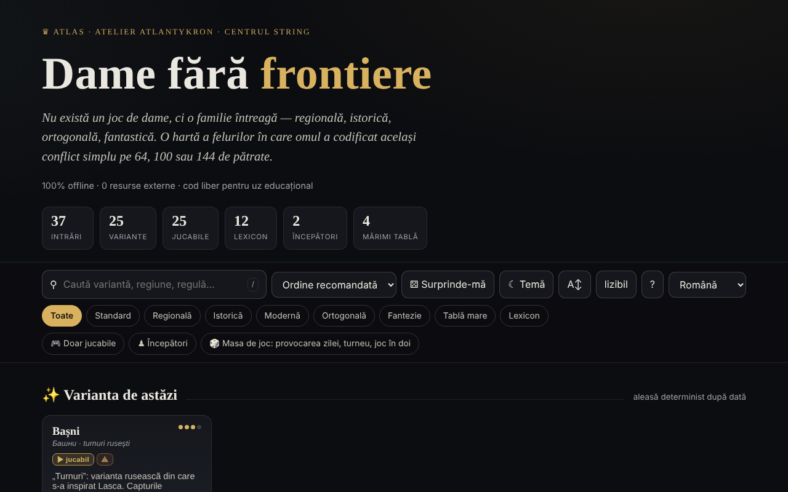

# Dame fără frontiere

[English](README.md) · **Română** · [Français](README.fr.md) · [Italiano](README.it.md) · [Español](README.es.md) · [Português](README.pt.md) · [Deutsch](README.de.md) · [Magyar](README.hu.md)

**Versiune:** 1.2.1 · **Ultima actualizare:** 2026-10-19

Limbile interfeței: **Română, English, Français, Italiano, Español, Português (PT), Deutsch, Magyar**

Atlas al variantelor de dame, cu motoare de joc locale — într-un singur fișier HTML.

**Live:** https://chiuta.github.io/Dame-fara-frontiere/

## Ce este

Dame fără frontiere este un atlas interactiv al familiei de jocuri de dame (regionale, istorice, ortogonale, fantastice), pe table de 64, 100 sau 144 de pătrate. Fiecare variantă are o fișă cu reguli și date rapide, iar variantele jucabile pot fi jucate local împotriva calculatorului. Aplicația se declară companion al proiectului „Șah fără frontiere”.

## Funcții

- 25 de variante (internațională, englezească, braziliană, rusească, canadiană, italiană, spaniolă, portugheză, cehă, germană, pool, varianta uzuală RO, thailandeză, turcească, frizonă, armenească, Dameo, Croda, Lasca, Bașni, Cheskers, Damath, antidame, antidame internațională, dame diagonală) și 12 intrări de lexicon (damă, captură obligatorie, captură maximă, damă zburătoare, notație numerică, FMJD, promovare etc.).
- Căutare, sortare (ordine recomandată, titlu A→Z / Z→A, dificultate crescătoare / descrescătoare), filtre „Doar jucabile” și „Începători”, „Varianta de astăzi” (aleasă determinist după dată), „Surprinde-mă”.
- Joc local „Joacă local · vs AI”: alegi culoarea (Albe / Negre) și nivelul (Ușor / Mediu / Avansat), cu „Joc nou”, „Anulează”, „Indiciu” și „Mod relaxat” (captură neobligatorie).
- „⧉ Copiază partida” și „⤓ Salvează .txt” în fereastra de joc: antet (variantă, tablă, nivel, rezultat) și mutările în notație pe coordonate (nu PDN oficial); generate local.
- Motoare locale: generic parametrizat, de turnuri (Bașni, Lasca), de scor aritmetic (Damath) și hibrid șah×dame (Cheskers), cu căutare alpha-beta. Aplicația avertizează cu ⚠ variantele implementate aproximativ.
- Export CSV al listei și citare BibTeX.
- Temă luminoasă/întunecată, mărime text „lizibil”.

## Funcții noi (1.1.0) — „Masa de joc”

Se deschid din butonul „🎲 Joc în doi · analiză · zilnic” (în fereastra de joc) sau „🎲 Masa de joc” (pagina principală), într-un dialog cu cinci file:

- **Joc în doi prin FFF.p2p** — două persoane, WebRTC direct între browsere, **fără server**: schimbi manual două coduri (copiere/lipire sau cod QR), apoi jocul rulează în „lockstep”: gazda (albele) validează și numerotează fiecare mutare, oaspetele (negrele) o aplică doar după ecoul gazdei; la orice divergență se retrimite starea completă. Funcționează pentru variantele de dame jucabile (alegi varianta pe gazdă). Bară „Joc online” cu remiză / joc nou (ofertă + accept/refuz), renunțare și deconectare; la deconectare poți continua singur din poziția curentă. **Limite:** NAT-urile simetrice (rețele mobile/corporative) nu se pot traversa fără STUN/TURN; se poate completa un server STUN (opt-in, gol implicit) — atunci adresa IP publică ajunge la acel server; adversarii își văd reciproc adresa IP; o partidă întreruptă nu se reia după reîncărcarea paginii; nu există chat.
- **Analizor local** — „Analizează poziția” (evaluare în „piese”, cea mai bună mutare și clasamentul mutărilor, căutare alpha-beta cu limită de timp ≈ 0,7 s, deci adâncimea depinde de dispozitiv) și „Analizează partida” (evaluează fiecare poziție, marchează greșelile). Pentru Damath și Cheskers evaluarea e doar materială (spus în interfață). Nu înlocuiește un motor profesionist; dezactivat în joc online.
- **Provocarea zilei** — o problemă „găsește mutarea cea mai bună” generată **determinist din dată** (aceeași pentru toată lumea în aceeași zi, fără rețea; căutare cu adâncime fixă, nu cu timp); explicație la mutarea greșită (diferența de evaluare) și serie de zile rezolvate (local).
- **„❓ De ce nu pot muta?”** — atingi o piesă sau un pătrat nepermis și aplicația spune de ce (nu e rândul tău, piesa e a adversarului, există o captură obligatorie, piesa nu are mutări, mutarea continuă o captură multiplă etc.); buton și tasta `W`.
- **Joc de la tastatură și anunțuri audio** — selecție și mutare cu săgeți/Enter pe tablă, tastele `L` (ultima mutare), `S` (starea), `M` (piesele care se pot muta), `W` (de ce nu pot muta); anunțuri în regiune `aria-live` și, opțional, voce (Web Speech, dacă browserul are o voce în limba paginii; altfel spune explicit că nu e disponibilă).
- **Turneu Elo local** — Eu, AI ușor/mediu/avansat și alte persoane la aceeași tablă, round-robin (opțional tur–retur); meciurile se joacă pe tablă sau se simulează AI–AI cu adâncime fixă; clasamentul și Elo-ul se recalculează din rezultate; export JSON/CSV și import. Scala Elo este **internă** turneului, nu comparabilă cu FIDE/FMJD.

Teste: `node tests/fff-r8.test.mjs` (Playwright, rețea blocată, 2 pagini pentru P2P, axe).

## Manual de utilizare

1. Deschide pagina și răsfoiește cardurile; filtrează cu „Doar jucabile” sau „Începători”, sau caută cu `/`.
2. Deschide o fișă (rezumat, „Reguli cheie”, „Date rapide”, „Înrudite”).
3. Dacă varianta are motor, apasă „▶ Joacă local · vs AI”, alege culoarea și nivelul.
4. Pe tablă apasă o piesă, apoi un pătrat evidențiat. La capturi multiple continuă să apeși pătratele; secvența se aplică când e completă.
5. Folosește „↶ Anulează”, „💡 Indiciu” sau „↺ Joc nou”; „Mod relaxat” face captura neobligatorie.
6. Scurtături: `/` focalizează căutarea, `R` variantă aleatoare, `B` filtru începători, `T` comută tema, `A` mărime text, `Esc` închide fereastra.
7. „⤓ Export CSV” descarcă lista; „⤓ Citează (BibTeX)” oferă citarea.
8. „Despre acest atlas →” explică tema, motoarele și limitele (motoare didactice, nu pentru analiză profesionistă).

## Confidențialitate și rețea

- **Stocare locală:** `localStorage`, chei cu prefixul `dff_` (temă, mod lizibil, variante explorate, un marcaj intern) și `dff_r8_` (preferințe de anunțuri/voce, turneu, serie zilnică, cache-ul problemei zilei); kitul FFF adaugă copie de siguranță (export/import/ștergere) și fereastra „Transparență” din numărul versiunii.
- **Rețea:** în cod nu există `fetch`, CDN sau resurse externe (egress declarat: 0); singura comunicare este jocul în doi opțional, prin WebRTC direct între cei doi jucători, cu semnalizare manuală (coduri schimbate de voi) și, doar dacă introduci unul, un server STUN; aplicația afirmă „0 resurse externe”, fără cont și fără tracking. Linkurile către Buy Me a Coffee, creativecommons.org sau alexio.tf sunt simple hiperlegături, deschise doar la click.

## Rulare locală / offline

Descarcă `index.html` și deschide-l în browser; nu necesită internet.

## Licență

Licență MIT — vezi fișierul `LICENSE`. Antetul din `index.html` și textul din interfață indică aceeași licență (o mențiune anterioară „CC-BY-SA 4.0” din interfață a fost eliminată la audit, 2026-10-11, pentru a elimina contradicția).

## Istoric / Changelog

- 1.1.0 — 2026-10-14 (runda 8, C1a): Masa de joc — joc în doi P2P, analizor local, provocarea zilei, „de ce nu pot muta?”, tastatură + anunțuri audio, turneu Elo local; kit FFF (core, label, bundle, qr, p2p, tts) cu `app.json`; CSP: `script-src` cu hash-uri recalculate (+ `blob:` ca de obicei pentru kit); teste `tests/fff-r8.test.mjs`.
- 1.0.0 — 2026-10-12: versiunea și data ultimei actualizări sunt afișate în aplicație
- Runda 7: tabla în tema întunecată are acum pătrate clar distincte (contrast ≈ 3:1) și piese negre cu contur deschis; în Damath operatorii (+ − × ÷) și valorile de pe piese, precum și literele pieselor din Cheskers, erau scrise cu ~4,5 px și acum se scalează cu dimensiunea tablei (≈ 13–22 px); titlurile din ferestre (Reguli cheie, Date rapide, Scurtături etc.) sunt `h3` (ierarhie corectă, axe `heading-order`); butonul „Joacă împotriva AI” și selectorul „Albe/Negre” respectă contrastul în tema luminoasă; tema implicită urmează `prefers-color-scheme` când nu există o alegere salvată.
- Adăugat export al partidei curente (copiere / .txt); CSP: `script-src` pe hash SHA-256 (5 scripturi), fără `'unsafe-inline'`. Verificat: căutarea „englez” lasă 6 carduri vizibile (contorul arată „6 din 37 intrări”; cardurile din rafturile ascunse rămân în DOM, dar nu sunt afișate).
- Căutarea ignoră diacriticele, acceptă mai multe cuvinte (toate trebuie să apară), ordonează rezultatele cu potriviri în titlu primele și ascunde rafturile „Varianta de astăzi / Esențiale / Exotice” cât timp căutarea e activă; contorul arată „N din 37 intrări”.
- Bara de căutare și filtre este reper `role="search"`, iar widgetul de sprijin este `complementary`; axe-core: 0 violări la 1280 și 360 px.
- Analiza de partide: din 1.1.0 există un analizor local simplu (vezi „Funcții noi”); rămâne didactic, nu pentru analiză profesionistă.

## Mărci

Numele de jocuri sunt denumiri comerciale ale deținătorilor lor, folosite descriptiv; proiectul nu este afiliat cu aceștia.

## Audit

Audit: 2026-10-10 — verificat cu Playwright și axe-core (WCAG 2.1 AA, ambele teme); verificat în cod: fără `fetch`/CDN. Corectate: culoarea titlurilor de card (nu moștenea culoarea paginii pe sistemele cu temă luminoasă), contrast pe butonul activ în tema luminoasă, un checkbox decorativ focalizabil.

## Autor

Alexio — Alexandru-Ionuț Chiuță, contact: alexio@trom.tf. Aplicația menționează Atlantykron, Editura Tornada și Centrul StrING.

## Rezumat

Un atlas cu 25 de variante de dame, plus 12 intrări de lexicon, cu adversari AI locali (căutare alfa-beta) pentru variantele jucabile. Un singur fișier HTML, interfață în română, fără cereri externe; tema și variantele explorate se păstrează în localStorage (prefix `dff_`). Din 1.1.0: o „Masă de joc” cu joc online în doi prin WebRTC (semnalizare manuală, fără server), un analizor local simplu, un puzzle zilnic determinist, explicații „de ce nu pot muta?”, joc cu tastatura cu anunțuri vocale și un turneu Elo local. Licență MIT (vezi LICENSE).
